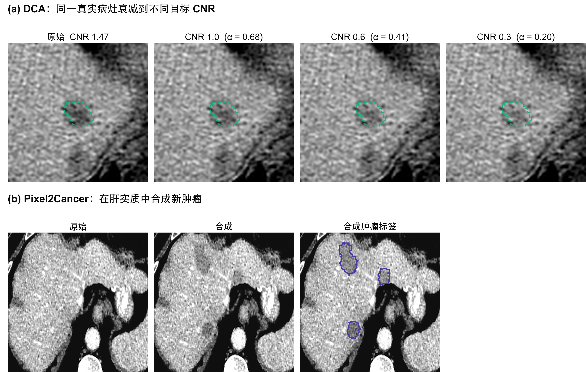
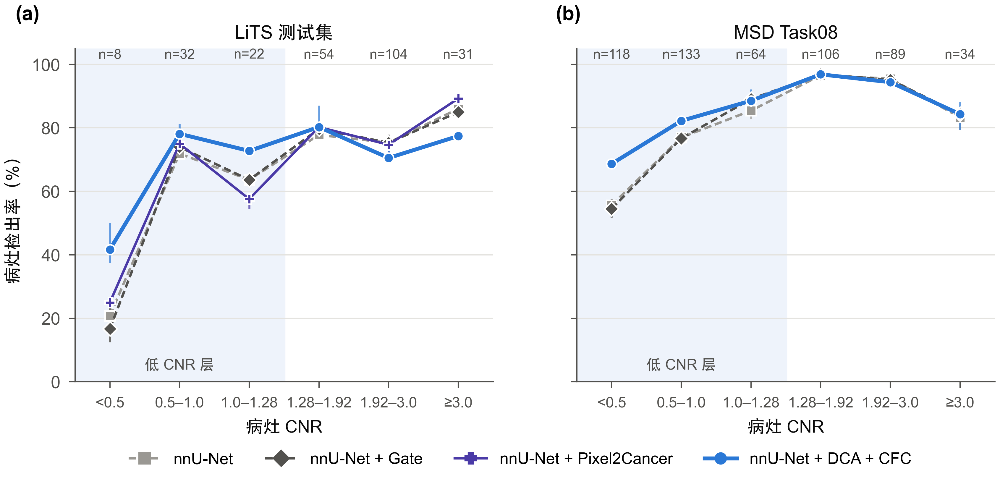
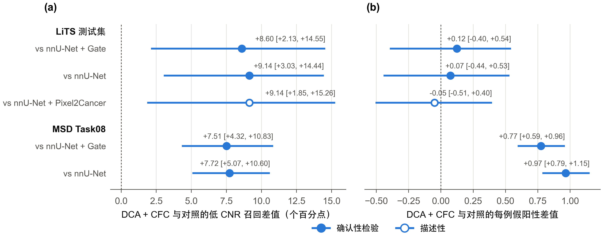
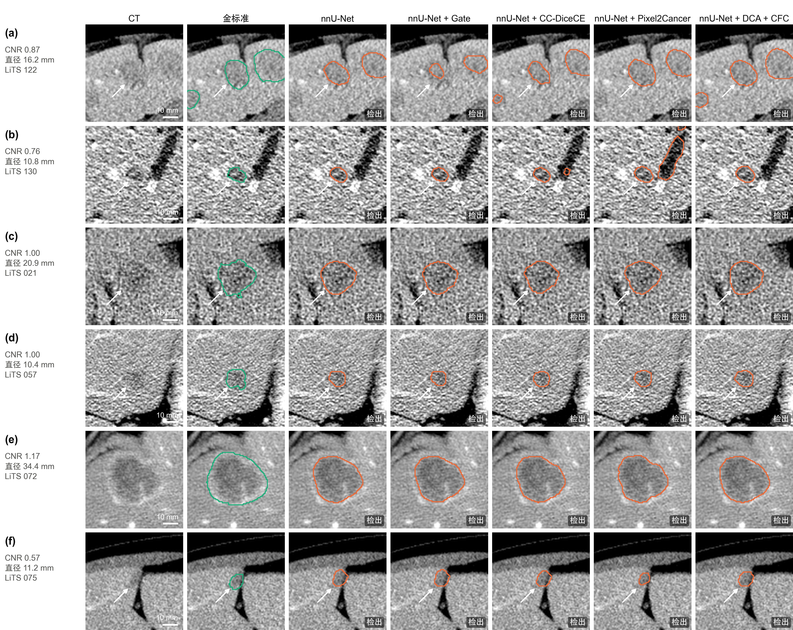

# 可检出性校准的对比度衰减与特征一致性：提高计算机断层扫描中低对比度肝肿瘤的检出

**英文标题：** Detectability-calibrated contrast attenuation and feature consistency for low-contrast liver tumor detection in computed tomography

> **版本说明（投稿前删除）**
>
> - 本稿按 EAAI / ESWA / KBS 上同方向论文的结构重写（对照见 `manuscript/EAAI写作对照.md`），数字与 `论文_中文_可检出性训练.md` 相同，均来自仓库中已归档的结果文件（冻结协议 `c2b8cae`，`results/test_protocol/`）。
> - EAAI 的硬性要求（不满足会被直接拒稿）：摘要须分别说明"人工智能方面的贡献"和"工程应用"；标题和摘要中不得出现未定义的缩写；全文单栏排版。摘要不超过 250 词；亮点 3–5 条，每条不超过 85 个字符（含空格）。英文标题、亮点和摘要已按这些要求写好并核对过长度。
> - 图 3、6、7、8、10 为 2026-10-14 新增（脚本 `manuscript/figures/src/figs_extra.py`，选例规则见计划 §11），原图 3、4、5 改为图 4、5、9。
> - `[[待填]]` 为尚待补充的内容：作者信息与声明。MSD Task08 外部验证结果来自 `results/external_msd08/`（提交 `632fbb7`）。

---

## Highlights（英文，提交时单独成文件）

- Missed low-contrast liver tumors are confidently predicted as liver tissue
- Lesion contrast is attenuated to targets drawn from hard training lesions
- Feature consistency stabilizes decoder features when lesion contrast drops
- Both modules act only in training: no network change, no inference overhead
- Low-contrast recall +9.1 points on held-out test, +7.7 at an external center

（中文对照：①漏检的低对比度肝肿瘤被网络明确判为肝脏；②按困难训练病灶的经验分布把病灶对比度衰减到目标值；③特征一致性使病灶变淡时解码器特征保持稳定；④两个模块只在训练时使用，不改网络，推理无额外开销；⑤低对比度召回在留出测试集上提高 9.1 个百分点，在外部中心数据上提高 7.7 个百分点。）

## Abstract（英文，248 词）

Automatic liver tumor segmentation in computed tomography still misses lesions whose intensity is close to that of surrounding liver parenchyma. Failure analysis of a pretrained three-dimensional U-Net shows that these lesions are confidently classified as liver, so lowering the decision threshold or adding contrast-oriented network modules does not recover them. As the contribution in artificial intelligence, we propose two training-only modules. Detectability-calibrated contrast attenuation shifts each real lesion's mean intensity towards the surrounding parenchyma, so that its contrast-to-noise ratio matches a target drawn from the empirical distribution of hard training lesions, preserving lesion texture and shape. Contrast-invariant feature consistency aligns the decoder features of the attenuated input with those of the original input around the attenuated lesions. Neither module changes the network or adds inference cost. As the engineering application, the modules are integrated into a standard self-configuring segmentation pipeline for computer-aided liver tumor detection. On the Liver Tumor Segmentation benchmark, with the selection rule and statistics frozen before a single evaluation on 27 held-out patients, the method raised low-contrast lesion recall from 62.4% to 71.5% (+9.1 percentage points, 95% confidence interval 3.0 to 14.4, adjusted p = 0.006) over a baseline with identical training budget, while false positives per scan changed from 1.99 to 2.06. No baseline threshold within this false-positive budget exceeded 64%. On 303 scans from an independent institution, recall rose from 70.7% to 78.4% (adjusted p < 0.001), with 0.97 more false positives per scan. The cost was lower recall for small high-contrast lesions.

**Keywords:** Liver tumor segmentation; Low-contrast lesion detection; Detectability; Data augmentation; Feature consistency; Computed tomography

## 摘要（中文）

计算机断层扫描（CT）上的肝肿瘤自动分割，仍会漏检强度与周围肝实质接近的病灶。我们对一个预训练的三维 U-Net 做了漏检分析，发现这类低对比度病灶被网络明确判为肝脏，因此降低判定阈值或加入针对对比度的网络模块都无法把它们找回。**在人工智能方面**，我们提出两个只在训练时使用的模块。可检出性校准的对比度衰减（DCA）把每个真实病灶的平均强度向周围肝实质平移，使其对比噪声比（CNR）等于从训练集困难病灶的经验分布中抽取的目标值，同时保留病灶的纹理和形状；对比度不变特征一致性（CFC）在被衰减病灶附近，使衰减输入的解码器特征与原输入的特征保持一致。两个模块都不改变网络，也不增加推理开销。**在工程应用方面**，这两个模块被集成到标准的自配置分割流程（nnU-Net）中，用于计算机辅助的肝肿瘤检出。在 LiTS 基准上，方法选择规则、主要终点和统计方法在测试前冻结，27 例留出病人只评估一次。与预训练和训练预算完全相同的基线相比，低对比度病灶的召回从 62.4% 提高到 71.5%（+9.1 个百分点，95% 置信区间 3.0–14.4，校正后 p = 0.006）；每例假阳性从 1.99 变为 2.06，肿瘤 Dice 从 74.6% 变为 74.0%。在相同的假阳性预算内，任何判定阈值都不能使基线的低对比度召回超过 64%。在来自另一家机构的 303 例外部数据（MSD Task08）上，低对比度召回从 70.7% 提高到 78.4%（校正后 p < 0.001），每例假阳性增加 0.97。代价是高对比度小病灶的召回有所下降。

---

## 1 引言

肝癌是癌症相关死亡的主要原因之一。增强 CT 是肝肿瘤检出、分期和随访的标准影像手段，体素级的肿瘤勾画可用于体积测量、手术与消融规划以及疗效评估 \cite{bilic2023lits}。人工勾画费时，且随工作量增加容易出现漏检和误检 \cite{hu2024tmplits}，因此自动肝肿瘤分割一直是计算机辅助诊断中的重要问题。LiTS 基准显示，肝脏分割已接近解决，而肿瘤分割仍有明显差距；基准作者还指出，分割指标好的方法不一定是好的病灶检测器 \cite{bilic2023lits}。

造成这一差距的一个关键因素是病灶与周围肝实质的对比度。我们用病灶-肝脏对比噪声比（CNR）来度量：病灶平均强度与病灶外 2–6 个体素的肝脏环带平均强度之差的绝对值，除以环带强度的标准差。在 LiTS 训练集的 518 个病灶中，CNR 的中位数只有 1.62，三分位点为 1.28 和 1.92。也就是说，三分之一的病灶 CNR 低于 1.28，在单期增强 CT 上本身就难以辨认。在我们的强基线（VoComni 预训练的三维 nnU-Net，下文简称 nnU-Net 基线）上，验证集低 CNR 层的病灶召回为 64%，而中、高 CNR 层为 83–87%（图 1）。低对比度漏检因此是这一任务中最主要的可改进空间。

现有的改进大致分为三类。（1）**网络结构**：在 U-Net 中加入注意力、多尺度融合、边界感知或频域分支 \cite{cheng2024egunetr,hu2024msml,ma2025msffe,yang2025camouflaged,ju2026uncertain}。（2）**损失函数**：实例级损失使每个病灶在损失中权重相同 \cite{kofler2023blob,bouteille2026ccdicece}。（3）**数据增强与合成**：病灶级复制粘贴 \cite{yang2021tumorcp,dai2022softcp,jin2025ipacp}、基于先验的正样本增强 \cite{yu2027iapa} 和合成肿瘤 \cite{hu2023labelfree,chen2024difftumor}。这些方法有以下局限。第一，结构改进在严格配置的 nnU-Net 基线下收益往往不稳定 \cite{isensee2024revisited}；我们自己尝试的两种针对对比度设计的结构模块，都没有提高低 CNR 召回（第 3.3 节）。第二，实例级损失通过放宽检出来提高召回，常伴随精确率下降 \cite{bouteille2026ccdicece}。第三，现有增强方法的强度扰动都不以"可检出性"为目标：它们不知道模型在哪个对比度区间上薄弱，扰动后病灶的 CNR 也不受控制。第四，多数工作只报告 Dice 等分割指标，很少按对比度分层报告检出，也很少在事先冻结的协议下评估，难以判断改进是否真的落在难检出的病灶上。

因此，一个有待回答的问题是：

> **能否在不改变网络、不增加推理开销的前提下，让分割网络学会检出它原本"看不见"的低对比度病灶？**

为回答这一问题，我们先对强基线的漏检做诊断（第 3 节）。诊断显示，漏检的低 CNR 病灶内，基线输出的肿瘤概率几乎为零，降低阈值只能找回不到 1 个百分点；而图像中的多尺度强度对比足以把这些病灶与肝实质区分开。这说明问题不在决策阈值，也不在网络容量，而在于网络在训练中很少见到这一对比度区间的病灶。据此，我们不改网络，而改训练样本的可检出性分布，提出两个训练模块：**可检出性校准的对比度衰减（DCA）**把真实病灶的对比度精确衰减到模型的薄弱区间；**对比度不变特征一致性（CFC）**使网络在病灶变淡时保持同样的表示（图 2）。两者合用即 DCA + CFC，下文记为 DCA + CFC。

本文的主要贡献如下：

- **研究问题：**与以提高整体 Dice 为目标的工作不同，我们针对低对比度肝肿瘤的漏检，并通过 CNR 分层、漏检病灶的概率分析和结构干预实验，说明强基线的这类漏检是表示层面的问题，不能靠调阈值或增加结构模块解决。
- **技术设计：**我们提出 DCA 和 CFC 两个即插即用的训练模块。DCA 按训练集低 CNR 病灶的经验分布，把真实病灶的 CNR 精确衰减到目标值，保留病灶的纹理、形状和解剖上下文；CFC 约束衰减前后的解码器特征一致。两者不引入可学习参数，不改变网络结构，推理零开销，所有超参数在训练前由训练集统计确定，不在验证集上调参。
- **有效性与可信度：**方法选择规则、主要终点、比较对象和统计方法在测试前写入冻结协议，27 例测试集只评估一次。在此协议下，方法相对 nnU-Net 基线和门控 nnU-Net 显著提高了低 CNR 召回；我们同时报告同等假阳性下的比较、逐病例留一敏感性分析、按 CNR × 大小的分层结果（包括本方法的代价）、与实例级损失、合成肿瘤方法和主流架构的比较、在另一家机构 303 例数据上按同一协议的外部验证，以及迁移到另一种网络的结果。

本文其余部分安排如下：第 2 节回顾相关工作；第 3 节分析强基线的漏检；第 4 节介绍方法；第 5 节介绍数据集；第 6 节报告实验结果（含外部验证）；第 7 节讨论方法的机制、代价、工程应用价值与局限；第 8 节总结全文。

---

## 2 相关工作

### 2.1 肝肿瘤分割

H-DenseUNet 结合二维层内特征与三维层间上下文 \cite{li2018hdenseunet}。nnU-Net 自动配置预处理、网络和训练流程，在许多三维分割任务上达到最优 \cite{isensee2021nnunet}。此后的工作主要沿网络结构展开：Swin UNETR \cite{hatamizadeh2022swinunetr}、MedNeXt \cite{roy2023mednext}、U-Mamba \cite{ma2024umamba} 引入长程建模；EG-UNETR、MSML-AttUNet、MSFFE-Net 等加入边缘引导、注意力和多尺度融合 \cite{cheng2024egunetr,hu2024msml,ma2025msffe}；Yang 等把边界模糊、难以与肝实质区分的肿瘤视为"伪装目标"，用多尺度伪装特征挖掘减少漏检 \cite{yang2025camouflaged}；Ju 等建模边界区域的不确定性以分割多尺度肝肿瘤 \cite{ju2026uncertain}；Hu 等用证据理论同时给出多期相分割结果及其可信度 \cite{hu2024tmplits}。VoCo 系列在大规模 CT 上预训练三维编码器 \cite{wu2024voco,wu2024largescale}。大规模复评发现，许多相对 nnU-Net 的改进在严格验证下消失 \cite{isensee2024revisited}。

与这些工作不同，本文不设计新的网络，而改变训练样本；方法与网络结构无关，以同预训练、同训练预算的 nnU-Net 为基线。

### 2.2 病灶级增强与合成

TumorCP 在线地把肿瘤从一个病例复制到另一个病例，并对复制对象做几何和强度变换 \cite{yang2021tumorcp}；Soft-CP 离线混合，并用 gamma、模糊和噪声扰动病灶强度 \cite{dai2022softcp}。IPA-CP 在半监督框架中按教师-学生预测的不确定性自适应地调整复制粘贴的强度，以改善小肿瘤分割 \cite{jin2025ipacp}。IAPA 构建融合强度与解剖信息的病灶图谱，在先验约束下生成正样本，用于多病灶分割 \cite{yu2027iapa}。Hu 等在健康肝脏中合成形状、纹理和强度可控的肿瘤 \cite{hu2023labelfree}；DiffTumor 用扩散模型合成可跨器官泛化的早期肿瘤 \cite{chen2024difftumor}；Pixel2Cancer 用元胞自动机模拟肿瘤的生长、侵袭和坏死来合成肿瘤 \cite{lai2024pixel2cancer}。窗位平移增强在训练时随机移动 CT 窗位，改善了造影时相不佳病例的肝病灶分割 \cite{ostmo2023window}。

这些方法扩充了病灶的位置、形状和外观，但它们的强度扰动不以可检出性为目标。DCA 不生成新病灶，只改变真实病灶的可检出性：病灶的形状、纹理和解剖上下文都是真实的，而对比度被精确控制在模型的薄弱区间内。

### 2.3 不变性与一致性学习

一致性正则要求模型在输入受到扰动时给出相近的预测或特征，广泛用于半监督医学图像分割 \cite{jin2025ipacp}。在 CT 表示学习中，TCS-MAE 按 CT 值区间对组织做遮挡，并约束原图与遮挡视图的特征一致，以学习对组织强度敏感的表示 \cite{zheng2026tcsmae}。CFC 与这类方法同属"扰动-一致性"的思路，但有三点不同：它用于有监督的分割训练，而不是自监督预训练；扰动是可检出性校准的病灶对比度衰减，而不是随机遮挡；一致性只在被衰减病灶的邻域内计算，并以原图的特征为固定目标（不回传梯度）。

### 2.4 可检出性

在信号检测理论中，Rose 模型把均匀背景中目标的可检出性与对比噪声比联系起来 \cite{rose1948sensitivity}，这也是 CT 影像质量评价中对比度-细节分析的基础。我们借用这一视角，用 CNR 刻画病灶的可检出性，并据此构造训练样本和分层评价。

---

## 3 问题分析：强基线为什么漏检低对比度病灶

本节所有分析只使用训练集和验证集（21 例，其中 18 例含肿瘤），不涉及测试集。

### 3.1 漏检集中在低 CNR 层

按训练集 518 个病灶冻结的 CNR 三分位点（1.28、1.92）分层，基线在验证集上低 CNR 层的召回为 64.1%，中、高 CNR 层为 83–87%。三个随机种子都漏检的 20 个病灶中，13 个属于低 CNR 层。低 CNR 漏检可分为两类：

- **大而淡：**中位直径 15.5 mm，中位 CNR 0.48。网络只在病灶内点亮很小的区域（中位 22 个体素，约占病灶的 0.7%），IoU 达不到 0.1，被记为漏检，同时多出一个假阳性。
- **小而淡：**中位直径 8.2 mm，中位 CNR 0.85。病灶内的肿瘤概率接近 0，完全没有被看到。

### 3.2 降低阈值无法找回

我们导出基线三个种子在验证集上的 softmax 概率，分析漏检病灶内的概率分布（表 1）。漏检的低 CNR 病灶（≥ 50 体素）内，肿瘤概率 90% 分位数的中位数仅为 0.001，肝脏概率均值的中位数为 0.993，99.8% 的体素被判为肝脏。在每例假阳性不超过 argmax 点 + 0.5 的约束下扫描判定阈值，最好的阈值（0.1）也只使低 CNR 召回从 63.3% 升到 64.1%（+0.9 个百分点）。漏检病灶不是"差一点被判为肿瘤"，而是被网络明确判为肝脏（图 1）。

{width=17cm}

**表 1** 基线漏检病灶（≥ 50 体素）内的概率统计（验证集，3 个种子，中位数）

| CNR 层 | 肿瘤概率最大值 | 肿瘤概率 90% 分位数 | 肝脏概率均值 | 判为肝脏的体素比例 |
|---|---:|---:|---:|---:|
| 低 | 0.352 | 0.001 | 0.993 | 0.998 |
| 中 | 0.001 | 0.000 | 0.999 | 1.000 |
| 高 | 0.000 | 0.000 | 0.730 | 0.784 |

### 3.3 结构模块没有提高低 CNR 召回

我们在同一基线上测试了两类针对对比度设计的结构模块（细节见补充材料）。**相位一致性频带路由**在五个编码器跳连上以相位一致性为条件重新加权小波频带。它减少了假阳性体素，但低 CNR 召回不变；仅用 15 个参数的跳连门控（下文的门控 nnU-Net，表中记为 nnU-Net + Gate）就能复现同样的效果，而删除等效直径 < 4 mm 的预测连通域后，门控相对 nnU-Net 基线的优势基本消失。**以肝实质为参照的多尺度对比门控**在 4 mm 后处理后的低 CNR 召回与门控 nnU-Net 相同（66.7% vs 66.7%）。

### 3.4 信息存在于图像中

在训练集 173 个低 CNR 病灶上，以肝实质为参照的多尺度强度对比区分病灶与远处肝实质的能力（病灶级 AUC 中位数 0.825），优于原始强度（0.750），配对增益 +0.055（按病例 bootstrap 95% CI [0.018, 0.086]）。这说明低 CNR 病灶在更大尺度的平均强度上仍可与肝实质区分，网络漏检它们并不是因为图像中没有信息。

**小结。**漏检的原因在于网络学到的表示：对低对比度病灶，网络给出的是确定的"肝脏"判断，改变网络结构也没有改变这一点。一个自然的解释是训练数据中低 CNR 病灶太少（训练集三分之一），而每个病灶只以原有的对比度出现。这引出本文的方法：在训练时系统地构造低可检出性的样本。

---

## 4 方法

### 4.1 概述

图 2 和算法 1 给出整体流程。记输入图块为 $x$，标签为 $y \in \{0, 1, 2\}$（背景、肝脏、肿瘤）。训练时，DCA 以概率 $p$ 生成衰减图块 $\tilde{x}$；网络 $f_\theta$ 在 $\tilde{x}$ 上用标准的深监督 DiceCE 训练；若有病灶被衰减，CFC 再用同一网络在原图块 $x$ 上的特征约束 $\tilde{x}$ 上的特征。推理时只运行 $f_\theta$，与基线完全相同。表 2 列出主要符号。

{width=17cm}

**表 2** 主要符号

| 符号 | 含义 |
|---|---|
| $x$, $\tilde{x}$ | 原图块、DCA 衰减后的图块 |
| $y$ | 体素标签（0 背景，1 肝脏，2 肿瘤） |
| $M_k$, $R_k$ | 第 $k$ 个肿瘤连通域及其肝实质环带 |
| $\mu_k$, $\nu_k$, $s_k$ | 病灶均值、环带均值、环带标准差 |
| $\mathrm{CNR}_k$, $t_k$, $\alpha_k$ | 病灶的对比噪声比、目标 CNR、衰减系数 |
| $F$ | 训练集低 CNR 层病灶 CNR 的经验分布 |
| $F^{(s)}_\theta$ | 网络在解码器尺度 $s$ 上的特征 |
| $\Omega$ | 被衰减病灶的并集膨胀 6 个体素后的区域 |
| $p$, $\lambda$, $\psi(e)$ | DCA 启用概率、CFC 权重、第 $e$ 个 epoch 的权重爬升系数 |

```
算法 1  DCA + CFC 的一次训练迭代
输入：图块 x，标签 y，网络 f_θ，低 CNR 经验分布 F，启用概率 p，权重 λψ(e)
 1: x̃ ← x；Ω ← ∅
 2: 以概率 p 执行：
 3:   对 y 中每个肿瘤连通域 M_k（体素数 ≥ 20）：
 4:     由式 (1) 得到环带 R_k；若 |R_k| < 10 则跳过
 5:     由式 (2) 计算 CNR_k；抽取 u ~ U(0,1)，t_k ← F⁻¹(u)
 6:     α_k ← min(1, t_k / CNR_k)；若 α_k < 1：
 7:       按式 (4) 平移病灶强度，更新 x̃；Ω ← Ω ∪ M_k
 8:   Ω ← 将 Ω 膨胀 6 个体素
 9: L ← L_DiceCE(f_θ(x̃), y)                      # 学生前向，保存解码器特征
10: 若 Ω 非空：
11:   在不回传梯度的条件下计算 f_θ(x)，取最细两层解码器特征作为目标
12:   L ← L + λψ(e) · L_CFC（式 (5)，仅在 Ω 内）
13: 反向传播 L，更新 θ
```

### 4.2 可检出性校准的对比度衰减（DCA）

**病灶与环带。**对标签中每个 26 连通的肿瘤连通域 $M_k$（体素数 ≥ 20），定义其肝实质环带

$$
R_k = \big(\mathcal{D}_6(M_k) \setminus \mathcal{D}_1(M_k)\big) \cap \{y = 1\} \setminus \mathcal{D}_1\Big(\textstyle\bigcup_{j \neq k} M_j\Big), \tag{1}
$$

其中 $\mathcal{D}_r$ 表示切比雪夫半径为 $r$ 的膨胀，即环带由病灶外 2–6 个体素的肝脏体素组成，并排除其他病灶附近的体素。环带体素少于 10 个的病灶不处理。

**测量 CNR。**在网络输入（nnU-Net 的 CT 归一化之后）上计算病灶均值 $\mu_k$、环带均值 $\nu_k$ 与环带标准差 $s_k$：

$$
\mathrm{CNR}_k = \frac{|\mu_k - \nu_k|}{s_k}. \tag{2}
$$

CT 归一化是全局仿射变换，CNR 对它不变，因此与第 1 节在 HU 上定义的 CNR 一致。

**目标 CNR。**设 $F$ 为训练集低 CNR 层（CNR < 1.28 的 173 个病灶）CNR 的经验分布。对每个病灶抽取 $u \sim \mathcal{U}(0, 1)$，取目标 $t_k = F^{-1}(u)$（用 0%、5%、…、100% 共 21 个分位点线性插值），令

$$
\alpha_k = \min\!\left(1, \frac{t_k}{\mathrm{CNR}_k}\right). \tag{3}
$$

$\alpha_k = 1$ 的病灶（本来就比目标更淡）不处理。

**衰减。**把病灶强度整体向环带均值平移：

$$
\tilde{x} = x - (1 - \alpha_k)(\mu_k - \nu_k)\, w_k, \qquad w_k = \max\!\big(G_\sigma * M_k,\; M_k\big) \odot \mathbb{1}[y > 0] \odot \big(1 - \textstyle\bigcup_{j \neq k} M_j\big), \tag{4}
$$

其中 $G_\sigma$ 为 $\sigma = 1$ 体素的高斯核，用于软化病灶边缘；后两项保证肝外组织和其他病灶不被改变。病灶内部 $w_k = 1$，平移量为常数，因此病灶纹理（强度相对均值的起伏）完全保留，CNR 近似变为 $\alpha_k \mathrm{CNR}_k = t_k$。每个训练样本以 $p = 0.5$ 的概率启用 DCA，启用时每个符合条件的病灶独立抽取目标，标签不变。

**设计动机。**一个更简单的做法是对每个样本抽取均匀的衰减系数 $\alpha \sim \mathcal{U}(0.3, 1)$（下文的均匀对比度衰减，UCA）。在这种做法下，高 CNR 病灶衰减后大多仍在中、高 CNR 层。DCA 让每个被衰减的病灶都落入基线失败的 CNR 区间，而且这个区间由训练集统计决定，不需要在验证集上调参。

图 3（a）给出了同一个真实病灶衰减到不同目标 CNR 的样例：病灶的形状、纹理和位置不变，只有与周围肝实质的平均强度差逐级缩小；作为对照，图 3（b）是第 6.3 节合成肿瘤方法（Pixel2Cancer）在肝实质中新生成的病灶。

{width=16cm}

### 4.3 对比度不变特征一致性（CFC）

DCA 只改变训练样本。为了让网络在病灶变淡时保持同样的表示，我们加入特征层面的一致性约束。设 $\Omega$ 为所有被衰减病灶的并集再膨胀 6 个体素后的区域。用同一网络、不回传梯度地计算原图块的解码器特征 $\bar{F}^{(s)} = \mathrm{sg}[F^{(s)}_\theta(x)]$，以及衰减图块的特征 $F^{(s)}_\theta(\tilde{x})$，其中 $s$ 取最细的两个解码器尺度。一致性损失为

$$
\mathcal{L}_{\mathrm{CFC}} = \frac{1}{|S|} \sum_{s \in S} \frac{\sum_{v} \Omega_s(v)\,\big(1 - \cos\big(F^{(s)}_\theta(\tilde{x})_v,\; \bar{F}^{(s)}_v\big)\big)}{\sum_{v} \Omega_s(v)}, \tag{5}
$$

其中 $\Omega_s$ 是 $\Omega$ 按最大池化下采样到尺度 $s$ 的结果，余弦相似度沿通道维计算。没有病灶被衰减的批次不计算这一项，也不做原图块的前向。选择余弦距离是因为它与特征的整体尺度无关；选择 stop-gradient，是为了让原图块的表示作为目标，而不是让两者向彼此靠拢。

### 4.4 总损失

$$
\mathcal{L} = \mathcal{L}_{\mathrm{DiceCE}}\big(f_\theta(\tilde{x}), y\big) + \lambda\,\psi(e)\,\mathcal{L}_{\mathrm{CFC}}, \qquad \psi(e) = \min\!\left(1, \frac{e + 1}{5}\right), \tag{6}
$$

其中 $\mathcal{L}_{\mathrm{DiceCE}}$ 为 nnU-Net 的深监督 Dice + 交叉熵，$\lambda = 1$。DCA 的 $p$、目标分布、CFC 的尺度数、膨胀半径和 $\lambda$ 都在训练前固定，没有调参。

### 4.5 计算复杂度

DCA 只对病灶包围盒做局部运算，连通域标记在 CPU 上完成；CFC 每个批次多一次不回传梯度的前向。两者都不引入可学习参数。在 RTX 3080 Ti 上，完整方法每个 epoch 约 93 秒，只用 DCA 约 87 秒，UCA 约 85–90 秒；显存峰值约 10.2 GB（只用 DCA 为 9.0 GB）。推理时两个模块都不运行，参数量（31.2 M）、计算量和推理时间与基线完全相同。

---

## 5 数据集与预处理

我们使用 LiTS 训练集的 131 例增强 CT \cite{bilic2023lits}，按病人划分为训练 83 例、验证 21 例（18 例含肿瘤）、测试 27 例（24 例含肿瘤）。验证集共 92 个病灶，其中低 CNR 39 个；测试集共 253 个病灶，其中低 CNR 62 个，分布在 19 例中。CNR 三分位点在训练集病灶上计算并冻结（1.28、1.92）。预处理采用 nnU-Net 的默认 CT 流程：重采样到 1.0 × 0.78 × 0.78 mm，按前景强度分布截断并做 z-score 归一化。LiTS 为公开数据集，本研究不涉及新的病人数据。

**外部数据。**外部验证使用医学分割十项全能（MSD）挑战的 Task08 肝血管数据 \cite{simpson2019msd,antonelli2022msd}：303 例有标注的门静脉期 CT，来自纪念斯隆-凯特琳癌症中心，不在 LiTS 的来源机构之中。我们用体素网格和强度指纹把这 303 例与本研究可获得的 151 例 LiTS CT 逐一比对，没有网格一致的配对，最小指纹差为 9.97 HU（判定重复的阈值为 2 HU），据此认为两者独立。Task08 只标注血管（1）和肿瘤（2），不标注肝脏；共 544 个肿瘤连通域，其中 211 例（70%）只有 1 个，提示部分病例可能只标注了目标病灶。层厚中位数为 5 mm。

---

## 6 实验与结果

### 6.1 实现细节

所有组使用相同的网络和训练设置（表 3），只在训练时的增强或损失上不同。网络为三维 nnU-Net `PlainConvUNet` \cite{isensee2021nnunet}，由 VoComni 预训练权重初始化 \cite{wu2024voco,wu2024largescale}。所有模型使用最终 epoch 的权重，不做检查点选择；每组训练 3 个随机种子，报告均值。

**表 3** 训练设置

| 项目 | 设置 |
|---|---|
| 框架 | nnU-Net v2，PyTorch 2.1，CUDA 11.8 |
| 体素间距 / 图块 / 批大小 | 1.0 × 0.78 × 0.78 mm / 128³ / 2 |
| 初始化 | VoComni |
| 训练长度 | 200 epoch × 250 次迭代 |
| 优化器 | SGD，Nesterov 动量 0.99，初始学习率 5 × 10⁻³（编码器 0.3×、解码器 0.5×），多项式衰减 |
| 其他 | 权重衰减 3 × 10⁻⁵；梯度裁剪 12；混合精度 |
| 数据增强 | nnU-Net 默认增强；DCA 在其之后、送入网络之前执行 |
| 推理 | 滑窗步长 0.5，Gaussian 加权，不做测试时增强 |
| 后处理 | 删除等效直径 < 4 mm 的预测肿瘤连通域（所有组相同） |
| 硬件 | 每个模型一张 RTX 3080 Ti（12 GB） |

### 6.2 评价指标

- **病灶检出：**真值与预测肿瘤分别按 26 连通标记，以 IoU > 0.1 做一对一匈牙利匹配，报告病灶召回、每例假阳性连通域数（FP/scan）和病灶 F1。
- **分层：**按冻结的 CNR 三分位（低、中、高）与病灶等效直径（< 10、10–20、> 20 mm）。
- **分割：**含肿瘤病例的逐病例肿瘤 Dice。
- **边界与体积（描述性）：**VOE、RVD、ASSD、HD95 和 MSSD（最大对称表面距离），表面距离按体素间距计算；含肿瘤病例若没有肿瘤预测，表面距离取图像对角线长度。
- **同等假阳性比较：**在阈值 {argmax, 0.5, 0.4, 0.3, 0.2, 0.1, 0.05} 上重新计算，比较各组在不超过 DCA + CFC 假阳性水平时可达到的最高低 CNR 召回。

### 6.3 对比方法

| 方法 | 内容 | 种子 |
|---|---|---|
| nnU-Net（A0） | VoComni 预训练的三维 nnU-Net，无额外模块（下文简称 nnU-Net 基线） | 3 |
| nnU-Net + Gate（A1） | 加 15 个参数的跳连门控（第 3.3 节；正文称门控 nnU-Net） | 3 |
| nnU-Net + CC-DiceCE（A12） | 加实例级损失 \cite{bouteille2026ccdicece}，与全局 DiceCE 1:1 相加 | 1 |
| nnU-Net + UCA（A11） | 加均匀对比度衰减（UCA）：$\alpha \sim \mathcal{U}(0.3, 1)$ | 3 |
| nnU-Net + DCA（A13a） | 只加 DCA（正文称仅 DCA） | 3 |
| nnU-Net + Pixel2Cancer（A14）† | 加 Pixel2Cancer 合成肿瘤 \cite{lai2024pixel2cancer}（离线变体，p = 0.9） | 3 |
| **nnU-Net + DCA + CFC（A13b，本文）** | **加 DCA 与 CFC（正文称 DCA + CFC）** | **3** |

各组的网络、预训练权重和训练预算完全相同，只在表中所列的一处不同；括号内为结果文件中的组名。CC-DiceCE 的实现与原文的差异见补充材料。

**合成肿瘤方法（Pixel2Cancer）。**为与近年的合成肿瘤方法比较，我们在冻结协议之后新增了 Pixel2Cancer \cite{lai2024pixel2cancer}：它用元胞自动机模拟肿瘤的生长、侵袭和坏死，在肝实质中合成肿瘤，不使用学习得到的生成模型，因而不会接触测试数据。我们直接调用其公开代码，为 83 例训练病例各离线生成 10 个变体（在 1 mm 各向同性网格上合成后映射回预处理网格），训练时以原文的概率 0.9 把训练样本换成随机变体，并把合成肿瘤加入前景采样；其余设置与 nnU-Net 基线完全相同，3 个种子。这一组在测试集解锁之后加入，测试集结果只作描述，不做假设检验。基于生成模型的方法（DiffTumor \cite{chen2024difftumor}、FreeTumor 等）公开的生成模型在包含 LiTS 的数据上训练，直接使用会接触本研究的测试病例，因此没有纳入。

**参考架构。**我们另外报告 TriALS 基准 \cite{elbatel2026trials} 中的架构在同一划分上的结果：三维和二维 nnU-Net \cite{isensee2021nnunet}、SegResNet \cite{myronenko2018segresnet}、U-Mamba \cite{ma2024umamba}、MedNeXt-L \cite{roy2023mednext}、Swin UNETR \cite{hatamizadeh2022swinunetr} 和 SAMed \cite{zhang2023samed}。它们按 TriALS 的默认设置训练（100 epoch、从头训练、单种子），测试集预测在本研究开发之前生成，开发过程中没有查看；我们只用本研究的评估流程重新计算其已有预测的指标。由于训练条件与本研究不同，这些结果只作参考。测试集预测使用训练中按验证折 EMA 伪 Dice 选出的 checkpoint_best，不使用测试时增强（本研究的模型使用 checkpoint_final）；SAMed-H 在最后约 15 个 epoch 训练崩塌（伪 Dice 降为 0），所用权重为第 79 个 epoch 的最佳权重。各模型训练结束时生成的验证集预测来自最终权重，与上述测试集权重不一致，因此不使用。为在同等条件下比较，我们在冻结协议之后、训练之前登记，另按 TriALS 的训练设置训练了 nnU-Net 和 nnU-Net + DCA + CFC（从头训练、标准 nnU-Net 优化器、100 epoch，各 3 个种子，测试集用 checkpoint_best；第 6.9 节）。

### 6.4 开发与测试流程

所有开发决定只用验证集，并在执行前写入计划文档的变更记录：（1）单种子筛选，继续条件为 4 mm 后处理后低 CNR 召回比门控 nnU-Net 至少高 5 个百分点，且每例假阳性最多多 0.3；（2）多种子复现，要求三种子均值满足同样条件且至少 2 个种子单独满足；（3）按"DCA + CFC → 仅 DCA → UCA"的事先固定顺序，第一个满足复现条件的组即为本文方法（这一顺序不是按验证集成绩排序）；（4）选定方法后，把组别、后处理、主要终点、比较对象和统计方法写入冻结协议并提交，再对 27 例测试集一次性推理和评估。

**主要终点**为 4 mm 后处理后的低 CNR 病灶召回（病灶汇总，3 个种子取均值）。**确认性比较**只有两个：DCA + CFC vs 门控 nnU-Net（主要）和 DCA + CFC vs nnU-Net 基线（次要），做 Holm 校正，双侧 α = 0.05。统计采用按病例的配对 bootstrap（10 000 次）。只有校正后 p < 0.05 且 95% CI 不含 0 时才写"提高"，其他比较只做描述。

### 6.5 定量比较

**验证集。**表 4 为验证集结果。UCA、仅 DCA 和 DCA + CFC 都满足复现条件，按事先顺序选定 DCA + CFC。需要说明的是，仅 DCA 在验证集上优于 DCA + CFC，即 CFC 在验证集上没有带来提升；而且验证集的增益高度集中，DCA + CFC 相对门控 nnU-Net 多检出的病灶（3 个种子合计 9 次）中有 8 次来自同一病例。因此验证集结果不能作为方法有效的证据，独立证据只来自测试集。

**表 4** 验证集结果（21 例，4 mm 后处理，3 个种子均值；CC-DiceCE 为单种子；† 为冻结协议之后新增的对比组，‡ 为冻结协议之后新增的训练条件，只作描述）

| 方法 | 低 CNR 召回（%） | 全部病灶召回（%） | FP/scan | 肿瘤 Dice（%） | 病灶 F1（%） |
|---|---:|---:|---:|---:|---:|
| ***VoComni 预训练，200 epoch（主实验）*** | | | | | |
| nnU-Net | 63.2 | 75.7 | 1.62 | 66.1 | 71.2 |
| nnU-Net + Gate | 65.8 | 77.2 | 1.56 | 68.1 | 72.6 |
| nnU-Net + CC-DiceCE | 76.9 | 82.6 | 2.86 | 70.5 | 66.7 |
| nnU-Net + UCA | 75.2 | 81.9 | 1.65 | 71.5 | 74.6 |
| nnU-Net + DCA | 76.9 | 82.6 | 1.56 | 73.6 | 75.8 |
| nnU-Net + Pixel2Cancer† | 73.5 | 79.4 | 2.21 | 64.8 | 69.1 |
| nnU-Net + DCA + CFC（本文） | 73.5 | 80.8 | 1.76 | 71.5 | 73.1 |
| ***从头训练，100 epoch（TriALS 设置）‡*** | | | | | |
| nnU-Net | 65.8 | 76.4 | 7.10 | 51.2 | 45.2 |
| nnU-Net + DCA + CFC | 70.9 | 77.5 | 6.08 | 53.3 | 49.3 |

**测试集。**表 5 和表 6 为测试集上的确认性结果。DCA + CFC 的低 CNR 召回为 71.5%，相对门控 nnU-Net 提高 8.6 个百分点（95% CI [2.1, 14.6]，Holm p = 0.011），相对 nnU-Net 基线提高 9.1 个百分点（[3.0, 14.4]，p = 0.006）。逐个去掉 19 个含低 CNR 病灶的病例重算主要差值，最大的单例贡献为 +1.9 个百分点，去掉该病例后差值仍为 +6.7；与验证集不同，测试集上的增益分布在多个病例中。表 5 下块为同等训练条件下与主流架构的比较，见第 6.9 节。

**表 5** 测试集结果（27 例，62 个低 CNR 病灶，4 mm 后处理，无测试时增强）。上块为主实验：VoComni 预训练、200 epoch、checkpoint_final，3 个种子均值（CC-DiceCE 为单种子）。下块为 TriALS 参考架构的训练条件：从头训练、标准 nnU-Net 优化器（学习率 10⁻²）、100 epoch、checkpoint_best；本研究的两组为 3 个种子均值，TriALS 架构为其公开设置下的单种子结果。† 冻结协议之后新增的对比组；‡ 冻结协议之后新增的训练条件；两者只作描述

| 方法 | 低 CNR 召回（%） | 全部病灶召回（%） | FP/scan | 肿瘤 Dice（%） | 病灶 F1（%） | 高 CNR < 10 mm 召回（%） |
|---|---:|---:|---:|---:|---:|---:|
| ***VoComni 预训练，200 epoch（主实验）*** | | | | | | |
| nnU-Net | 62.4 | 73.4 | 1.99 | 74.6 | 75.4 | 68.5 |
| nnU-Net + Gate | 62.9 | 73.8 | 1.94 | 74.1 | 75.9 | 68.5 |
| nnU-Net + CC-DiceCE | 66.1 | 82.2 | 4.00 | 73.2 | 73.1 | 83.7 |
| nnU-Net + UCA | 66.7 | 73.7 | 2.16 | 74.3 | 74.9 | 66.3 |
| nnU-Net + DCA | 68.3 | 71.7 | 2.07 | 74.3 | 74.0 | 62.3 |
| nnU-Net + Pixel2Cancer† | 62.4 | 74.0 | 2.11 | 75.2 | 75.3 | 69.9 |
| **nnU-Net + DCA + CFC（本文）** | **71.5** | 73.1 | 2.06 | 74.0 | 74.9 | 60.9 |
| ***从头训练，100 epoch（TriALS 设置）‡*** | | | | | | |
| nnU-Net | 60.8 | 64.3 | 7.06 | 54.7 | 53.9 | 56.5 |
| nnU-Net + DCA + CFC | 62.9 | 62.5 | 6.90 | 53.6 | 53.0 | 48.9 |
| nnU-Net 3D（TriALS） | 56.5 | 66.8 | 5.00 | 56.3 | 60.7 | 63.0 |
| nnU-Net 2D（TriALS） | 53.2 | 61.7 | 6.00 | 56.8 | 54.6 | 52.2 |
| SegResNet（TriALS） | 58.1 | 68.8 | 3.81 | 60.7 | 65.7 | 63.0 |
| U-Mamba（TriALS） | 61.3 | 65.6 | 4.04 | 57.2 | 62.9 | 56.5 |
| MedNeXt-L（TriALS） | 64.5 | 71.9 | 3.70 | 66.1 | 68.0 | 68.5 |
| SAMed-H（TriALS） | 58.1 | 67.2 | 7.04 | 62.9 | 55.5 | 64.1 |

**与合成肿瘤方法的比较。**Pixel2Cancer（†）在验证集上的低 CNR 召回与 DCA + CFC 相同（73.5%），但肿瘤 Dice 较低（64.8%）、每例假阳性较高（2.21）。在测试集上，它的低 CNR 召回与 nnU-Net 基线相同（62.4%），DCA + CFC 比它高 9.1 个百分点（配对 bootstrap 95% CI [1.9, 15.3]）；它的全部病灶召回（74.0%）和肿瘤 Dice（75.2%）略高于 DCA + CFC，差值区间都包含 0，每例假阳性相近（2.11 vs 2.06）。两个数据集上的方向不一致；验证集已用于开发、只有 39 个低 CNR 病灶，因此我们以测试集为主，但这一比较是描述性的。

**表 6** 确认性比较（配对 bootstrap 10 000 次，Holm 校正）

| 比较 | 角色 | 差值（个百分点） | 95% CI | Holm p | 结论 |
|---|---|---:|---|---:|---|
| DCA + CFC vs nnU-Net + Gate | 主要 | +8.6 | [2.1, 14.6] | 0.011 | 提高 |
| DCA + CFC vs nnU-Net | 次要 | +9.1 | [3.0, 14.4] | 0.006 | 提高 |

DCA + CFC 的全部病灶召回和肿瘤 Dice 与 nnU-Net 基线基本持平，每例假阳性增加约 0.1。CC-DiceCE 的全部病灶召回最高（82.2%），但每例假阳性为 4.00，约为其他方法的两倍，低 CNR 召回（66.1%）也低于 DCA + CFC。这与原文在 BraTS 上观察到的精确率下降一致 \cite{bouteille2026ccdicece}：逐连通域损失通过放宽检出提高召回，而 DCA + CFC 在几乎不增加假阳性的情况下，专门提高低对比度病灶的检出。

### 6.6 同等假阳性下的比较

一个自然的疑问是：DCA + CFC 的提升是否只是相当于把 nnU-Net 基线的阈值调低。表 7 和图 4 回答了这个问题。把判定阈值从 argmax 一路降到 0.05，nnU-Net 基线的低 CNR 召回最高只到 66.7%（每例假阳性 2.33），而 DCA + CFC 在默认 argmax 下（每例假阳性 2.06）已达到 71.5%。以 DCA + CFC argmax 点的假阳性（每例 2.06）为预算，逐个种子取预算内的最高低 CNR 召回再求均值：nnU-Net 基线为 62.9%，门控 nnU-Net 为 63.7%，DCA + CFC 为 74.2%。因此，DCA + CFC 的提升不能通过放宽 nnU-Net 基线的阈值得到。

**表 7** 测试集上不同判定阈值的每例假阳性 / 低 CNR 召回（%）（4 mm 后处理，3 个种子均值）

| 方法 | argmax | 0.5 | 0.4 | 0.3 | 0.2 | 0.1 | 0.05 |
|---|---|---|---|---|---|---|---|
| nnU-Net | 1.99 / 62.4 | 2.02 / 62.4 | 2.01 / 62.4 | 2.05 / 62.9 | 2.23 / 63.4 | 2.43 / 64.5 | 2.33 / 66.7 |
| nnU-Net + Gate | 1.94 / 62.9 | 1.86 / 62.9 | 1.98 / 62.9 | 2.00 / 64.0 | 2.09 / 64.0 | 2.32 / 65.1 | 2.41 / 66.1 |
| nnU-Net + DCA | 2.07 / 68.3 | 2.06 / 68.3 | 2.14 / 68.8 | 2.16 / 70.4 | 2.14 / 71.0 | 2.19 / 73.1 | 2.35 / 74.2 |
| **nnU-Net + DCA + CFC（本文）** | **2.06 / 71.5** | 2.01 / 71.5 | 2.05 / 72.0 | 2.15 / 72.0 | 2.16 / 73.1 | 2.31 / 74.2 | 2.46 / 72.6 |

{width=12cm}

### 6.7 分层分析

表 8 和图 5 按 CNR × 大小分层。提升集中在低 CNR 病灶，尤其是低 CNR 的小病灶（< 10 mm，从 36.8% 提高到 49.4%）；代价是高 CNR 小病灶的召回从 68.5% 降到 60.9%。

**表 8** 测试集按 CNR × 大小分层的召回（%，3 个种子均值；括号内为病灶数）

| CNR 层 | 大小 | nnU-Net | + Gate | + DCA | + DCA + CFC（本文） |
|---|---|---:|---:|---:|---:|
| 低 | < 10 mm（29） | 36.8 | 36.8 | 46.0 | 49.4 |
| 低 | 10–20 mm（18） | 77.8 | 81.5 | 83.3 | 85.2 |
| 低 | > 20 mm（15） | 93.3 | 91.1 | 93.3 | 97.8 |
| 中 | < 10 mm（25） | 53.3 | 56.0 | 54.7 | 57.3 |
| 中 | 10–20 mm（15） | 97.8 | 100.0 | 100.0 | 100.0 |
| 中 | > 20 mm（14） | 100.0 | 100.0 | 100.0 | 100.0 |
| 高 | < 10 mm（92） | 68.5 | 68.5 | 62.3 | 60.9 |
| 高 | 10–20 mm（31） | 96.8 | 95.7 | 87.1 | 94.6 |
| 高 | > 20 mm（12） | 100.0 | 100.0 | 100.0 | 100.0 |

{width=12cm}

图 6 按病灶 CNR 分区间给出检出率。在 LiTS 测试集上，DCA + CFC 的优势集中在 CNR < 1.28 的区间：CNR < 0.5 的 8 个病灶中检出率为 41.7%（nnU-Net 基线 20.8%、门控 nnU-Net 16.7%），CNR 1.0–1.28 的 22 个病灶中为 72.7%（nnU-Net 基线与门控 nnU-Net 均为 63.6%）；在 CNR ≥ 1.92 的区间，DCA + CFC 的检出率低于其他方法（例如 CNR ≥ 3.0 时为 77.4%，nnU-Net 基线 86.0%），对应第 7.2 节讨论的高对比度小病灶代价。MSD Task08 上的趋势相同：差距集中在 CNR < 1.0 的病灶（CNR < 0.5 时 68.6% 对 55.6% 和 54.5%），CNR ≥ 1.28 时三条曲线几乎重合。Pixel2Cancer 的曲线与 nnU-Net 基线接近。

{width=16cm}

### 6.8 消融实验

表 9 依次加入对比度衰减、可检出性校准和特征一致性。在测试集上，三步依次提高低 CNR 召回：对比度衰减本身 +4.3，可检出性校准 +1.6，特征一致性 +3.2 个百分点。在验证集上，前两步同样带来提升，但 CFC 使召回下降 3.4 个百分点。这些比较都是描述性的，不做假设检验。

**表 9** 消融实验：低 CNR 召回（%）/ 每例假阳性

| 配置 | 验证集 | 测试集 |
|---|---|---|
| nnU-Net | 63.2 / 1.62 | 62.4 / 1.99 |
| + 均匀对比度衰减（UCA） | 75.2 / 1.65 | 66.7 / 2.16 |
| + 可检出性校准（即 DCA） | 76.9 / 1.56 | 68.3 / 2.07 |
| + CFC（即 DCA + CFC，本文） | 73.5 / 1.76 | 71.5 / 2.06 |

### 6.9 与主流架构的比较及架构迁移

**同等训练条件下的比较。**表 5 下块把本研究的两组放到 TriALS 参考架构的训练条件下：从头训练，标准 nnU-Net 优化器（SGD，所有参数学习率 10⁻²，poly 衰减），100 epoch，测试集用 checkpoint_best、无测试时增强。网络与 TriALS 的 nnU-Net 3D 结构相同（31.2 M 参数）。这一实验在冻结协议之后、训练之前登记，各 3 个种子，只作描述。在这一条件下，nnU-Net + DCA + CFC 的低 CNR 召回为 62.9%，nnU-Net 为 60.8%，差值 +2.2 个百分点（配对 bootstrap 95% CI [−3.5, 7.1]），远小于主实验中的 +9.1；全部病灶召回（62.5% vs 64.3%）、每例假阳性（6.90 vs 7.06）和肿瘤 Dice（53.6% vs 54.7%）的差值区间都包含 0。改用 checkpoint_final 时，低 CNR 召回差为 +0.5（[−4.2, 5.0]）；验证集上为 +5.1（[−3.6, 11.1]）。高 CNR 小病灶的召回同样下降（48.9% vs 56.5%）。因此，在从头训练、100 epoch 的条件下，DCA + CFC 对低 CNR 召回的提升没有得到支持，主实验中的增益依赖预训练权重或更长的训练；为区分这两者，我们另按事先写定的解释规则训练了 200 epoch 的从头训练模型（[[待填：200 epoch 从头训练结果]]）。

与 TriALS 架构相比（同为从头训练、100 epoch），nnU-Net + DCA + CFC 的低 CNR 召回高于 nnU-Net 3D（56.5%）、nnU-Net 2D（53.2%）、SegResNet 和 SAMed-H（均为 58.1%），与 U-Mamba（61.3%）相近，低于 MedNeXt-L（64.5%）；但每例假阳性（6.90）高于除 SAMed-H 外的所有参考架构（3.70–6.00），肿瘤 Dice（53.6%）低于所有参考架构。需要注意，同一结构下，本研究流程训练的 nnU-Net 与 TriALS 的 nnU-Net 3D 相比，低 CNR 召回高 4.3 个百分点（[−5.0, 13.1]），每例假阳性多 2.06 个（[1.05, 3.06]）：两者的预处理（体素间距 0.78 mm 与 0.77 mm）和代码实现不同，跨流程的差异不能归于方法。因此，方法的作用以同一流程内 nnU-Net + DCA + CFC 与 nnU-Net 的比较为准，与 TriALS 架构的比较只作参考。Swin UNETR（每例假阳性 35.7，肿瘤 Dice 24.1%）和 SAMed-B（全部病灶召回 5.1%）在 TriALS 设置下训练失败，结果见补充材料。TriALS 还保存了 nnU-Net 3D、SegResNet 和 U-Mamba 开启镜像测试时增强的测试集预测：按同一流程评估，低 CNR 召回分别为 56.5%、59.7% 和 61.3%，与不开时相差 0–1.6 个百分点，每例假阳性降到 3.19–3.59（补充材料）。参考架构的参数量为：nnU-Net 2D 46.3 M，SegResNet 18.8 M，U-Mamba 58.4 M，MedNeXt-L 63.0 M，SAMed-H 641.7 M（含冻结的 SAM ViT-H 编码器，可训练参数 4.6 M）。

两块结果放在一起还说明，在 83 例训练数据上，预训练和训练长度对整体分割质量的影响大于网络结构的差别：主实验中各组的肿瘤 Dice 为 73.2%–75.2%、每例假阳性约 2，而从头训练 100 epoch 的所有模型肿瘤 Dice 为 53.6%–66.1%、每例假阳性为 3.70–7.06。

**架构迁移。**为检验方法能否用于其他网络，我们把 TriALS 配置的 SegResNet（从头训练，Adam，学习率 10⁻⁴，无深监督）放进本研究的训练流程，比较 SegResNet 与 SegResNet + DCA + CFC（设置与主实验中的 DCA + CFC 完全相同），各 2 个种子、200 epoch。CFC 使用 SegResNet 最细两层解码器的输出。这一实验在协议冻结后新增，只做描述性报告。

训练中出现了一个与架构有关的现象。SegResNet 的解码器块输出为残差和，其后没有归一化层；CFC 的余弦损失只约束特征方向、不约束大小，使解码器特征的幅值在训练中持续增长。在半精度（FP16）训练中，一个种子的解码器最大激活从第 108 个 epoch 的约 3.0 × 10⁴ 增长到第 150 个 epoch 的约 8.8 × 10⁴，超过 FP16 上限（65504）；从第 114 个 epoch 起损失频繁变为非有限值、更新被跳过。改用 bf16 后，该种子的最大激活在第 68 个 epoch 达到约 1.5 × 10⁵，训练在第 68–72 个 epoch 崩塌后只部分恢复（第 150 个 epoch 时最大激活约 1.7 × 10⁷）；另一个种子在第 150 个 epoch 时约为 6.5 × 10³，训练正常。作为对照，不加本文模块的 SegResNet 最大激活约为 200–300。nnU-Net 的每个解码阶段以实例归一化结束，因此主实验不受影响。

**表 10** SegResNet 上的迁移结果（4 mm 后处理；各 2 个种子；冻结后新增的描述性分析）

| 模型 | 种子 | 验证集低 CNR 召回（%） | 测试集低 CNR 召回（%） | 测试集全部召回（%） | 测试集 FP/scan | 测试集肿瘤 Dice（%） |
|---|---|---:|---:|---:|---:|---:|
| SegResNet | 0 | 74.4 | 54.8 | 68.0 | 2.67 | 67.6 |
| SegResNet | 1 | 74.4 | 61.3 | 70.4 | 2.78 | 67.8 |
| SegResNet + DCA + CFC | 0 | 61.5 | 58.1 | 53.0 | 3.04 | 53.9 |
| SegResNet + DCA + CFC | 1 | 5.1 | 9.7 | 9.1 | 6.89 | 12.0 |

在 SegResNet 上，DCA + CFC 没有带来提升。两个种子均值的测试集低 CNR 召回差为 −24.2 个百分点（配对 bootstrap 95% CI [−33.1, −14.1]），全部病灶召回差为 −38.1 个百分点，每例假阳性增加 2.24。均值主要受训练崩塌的种子影响；没有崩塌的种子在测试集上的低 CNR 召回与 SegResNet 相当（58.1% vs 54.8% 和 61.3%），但全部病灶召回和肿瘤 Dice 明显更低。两组的自动混合精度类型不同（SegResNet 为 FP16，加入本文模块后为 bf16）；由于没有单独训练 SegResNet + DCA，我们也无法区分 DCA 和 CFC 各自的作用。这一结果说明，DCA + CFC 的有效性目前只在 nnU-Net（解码阶段以实例归一化结束、使用预训练权重）上得到确认。结果文件见 `results/segresnet_transfer/`。

### 6.10 外部验证

为检验结论能否推广到另一家机构的数据，我们在 MSD Task08 的 303 例上做了外部验证（第 5 节）。方案在任何 Task08 推理之前写入计划文档：模型为 nnU-Net 基线、门控 nnU-Net 和 DCA + CFC 各 3 个种子（与测试协议相同的权重和推理设置，无测试时增强），CNR 定义、冻结的三分位点、病灶匹配规则、4 mm 后处理、主要终点、两项确认性比较、bootstrap 和 Holm 校正都与冻结协议相同。由于 CNR 的环带需要肝实质，而 Task08 没有肝脏标注，我们用一个固定规则构造参照：肝脏取 nnU-Net 基线 3 个种子预测的肝+肿瘤中至少 2 个一致的体素，肿瘤一律取 Task08 的肿瘤标签；所有模型使用同一参照。参照肝内的肿瘤体素比例中位数为 99.8%，303 例中只有 3 例低于 50%。

**表 11** MSD Task08 外部验证结果（303 例，544 个病灶，其中低 CNR 315 个，分布在 228 例中；4 mm 后处理；3 个种子均值）

| 方法 | 低 CNR 召回（%） | 全部召回（%） | FP/scan† | 肿瘤 Dice（%） | F1（%）† |
|---|---:|---:|---:|---:|---:|
| nnU-Net | 70.7 | 80.6 | 3.36 | 58.4 | 43.8 |
| nnU-Net + Gate | 70.9 | 80.8 | 3.55 | 58.4 | 42.7 |
| **nnU-Net + DCA + CFC（本文）** | **78.4** | **85.0** | 4.33 | **62.3** | 40.0 |

† Task08 的肿瘤标注可能不完整，部分"假阳性"可能是未标注的肿瘤，FP/scan 和 F1 只能作为上限参考。

DCA + CFC 的低 CNR 召回比门控 nnU-Net 高 7.5 个百分点（95% CI [4.3, 10.8]，Holm p < 0.001），比 nnU-Net 基线高 7.7 个百分点（[5.1, 10.6]，Holm p < 0.001），两项确认性比较都满足"提高"的条件。效应量与 LiTS 测试集（+8.6 和 +9.1）接近，由于低 CNR 病灶数是测试集的 5 倍，置信区间更窄。DCA + CFC 的 3 个种子（79.0%、77.8%、78.4%）都高于全部 6 个对照运行（69.5%–72.1%）；逐个去掉含低 CNR 病灶的病例重算主要差值，结果在 +7.1 到 +8.2 个百分点之间。按大小分层，低 CNR 病灶在 < 10 mm（45 个）、10–20 mm（80 个）和 > 20 mm（190 个）三层的召回分别从 36.3%、67.1%、80.7%（门控 nnU-Net）提高到 43.0%、72.5%、89.3%。全部病灶召回和肿瘤 Dice 也分别比门控 nnU-Net 高 4.2 和 3.8 个百分点。

与 LiTS 测试集不同，外部数据上的假阳性明显增加：DCA + CFC 每例比门控 nnU-Net 多 0.77 个，比 nnU-Net 基线多 0.97 个（LiTS 测试集上为 +0.12 和 +0.07），F1 因此低于两个对照。这些假阳性中有多少是未标注的肿瘤，目前无法区分。此外，肝参照来自 nnU-Net 基线的预测，可能使 CNR 分层略偏向 nnU-Net 基线的肝边界；由于所有模型使用同一参照，这一偏差不改变比较的方向。

**假阳性的来源（事后描述性分析）。**为了解外部数据上增加的假阳性落在哪里，我们在运行前登记了一个描述性分析：把 4 mm 后处理后未匹配的预测连通域按固定优先级分为四类——与 Task08 肿瘤有重叠的碎片、肝外（< 50% 落在参照肝内）、血管（≥ 30% 落在膨胀 1 体素的血管标签内）和肝内其他。与门控 nnU-Net 相比，DCA + CFC 每例增加的 0.77 个假阳性中，肝内其他类增加 0.84 个（95% CI [0.70, 0.99]），且主要是直径 < 10 mm 的小区域（+0.73）；肝外增加 0.10，血管类增加 0.04，而与已标注肿瘤重叠的碎片减少 0.20（[−0.30, −0.11]），可能反映 DCA + CFC 对已标注肿瘤的分割更完整。DCA + CFC 肝内其他类假阳性相对周围肝实质的对比度中位数为 1.54，低于门控 nnU-Net 的 1.91，提示新增的假阳性多为低对比度的小区域。增加量在只标注了 1 个肿瘤的 211 例（+0.75）和标注了多个肿瘤的 92 例（+0.84）中相近，因此不能简单地用"只标注了目标病灶"来解释。随机抽取的 16 个 DCA + CFC 独有的假阳性（补充材料）中，多数为肝边缘、裂隙附近或均匀实质中的数毫米小区域，个别为可见的低密度灶；没有放射科医生复核，我们不对其性质下结论。一种可能的解释是，DCA 使网络对微弱的局部强度差更敏感，在扫描条件不同的外部数据上，这种敏感性同时带来了更多低对比度小区域的误报；本研究没有直接检验这一解释。结果文件见 `results/external_msd08/`（假阳性分析在 `fp_analysis/` 中）。

图 7 给出外部数据上的示例。（a）–（c）是按事先规则选出的三个增益病灶（三个种子中 DCA + CFC 全部检出、门控 nnU-Net 全部漏检的低 CNR 病灶中直径最大的 3 个）：它们都是与肝实质几乎等密度的大病灶，门控 nnU-Net 没有分割，或只分割出其中密度略低的局部，按三维 IoU > 0.1 的规则计为漏检；DCA + CFC 覆盖的范围更大，但也没有完整分割出病灶。（d）是一个 DCA + CFC 独有的假阳性：位于肝边缘、直径约 4 mm 的小区域，与上文假阳性分析的描述一致。

{width=15cm}

图 8 汇总了 DCA + CFC 与各对照的差值。在 LiTS 测试集和 MSD Task08 上，低 CNR 召回的提升方向一致，95% CI 都不含 0；每例假阳性在 LiTS 测试集上与对照相当（相对门控 nnU-Net +0.12，[−0.40, 0.54]），在 MSD Task08 上增加 0.77–0.97 个，区间不含 0。

{width=16cm}

### 6.11 边界与体积指标

参考 LiTS 相关工作常用的指标，我们补充计算了 VOE、RVD、ASSD、HD95 和 MSSD（计算前登记，描述性）。肿瘤指标使用 4 mm 后处理后的预测，只在含肿瘤的病例上计算；肝脏指标比较预测的肝+肿瘤与金标准的肝+肿瘤。每个运行先取病例均值，再取 3 个种子的均值（表 12）。

**表 12** 测试集边界与体积指标（肿瘤：24 例含肿瘤病例；肝脏：27 例；Dice、VOE、RVD 为 %，距离为 mm；CC-DiceCE 为单种子；† 为冻结协议之后新增的对比组，只作描述）

| 方法 | 肿瘤 Dice | 肿瘤 VOE | 肿瘤 RVD | 肿瘤 ASSD | 肿瘤 HD95 | 肿瘤 MSSD | 肝脏 Dice | 肝脏 ASSD | 肝脏 HD95 |
|---|---:|---:|---:|---:|---:|---:|---:|---:|---:|
| nnU-Net | 74.6 | 38.9 | −12.4 | 6.25 | 39.1 | 68.9 | 96.8 | 1.57 | 10.2 |
| nnU-Net + Gate | 74.1 | 39.2 | −15.0 | 5.24 | 33.3 | 59.2 | 96.9 | 1.42 | 7.1 |
| nnU-Net + CC-DiceCE | 73.2 | 40.2 | +1.0 | 10.08 | 58.4 | 86.4 | 96.5 | 2.06 | 15.4 |
| nnU-Net + UCA | 74.3 | 39.1 | −5.6 | 6.57 | 39.6 | 65.2 | 96.8 | 1.52 | 9.1 |
| nnU-Net + DCA | 74.3 | 39.2 | −5.4 | 6.10 | 33.6 | 60.7 | 96.8 | 1.42 | 8.3 |
| nnU-Net + Pixel2Cancer† | 75.2 | 38.5 | +2.7 | 5.00 | 35.1 | 61.4 | 96.7 | 1.32 | 6.4 |
| **nnU-Net + DCA + CFC（本文）** | 74.0 | 39.4 | −3.4 | 6.24 | 30.0 | 64.0 | 96.8 | 1.42 | 6.0 |

在测试集上，DCA + CFC 与门控 nnU-Net 的肿瘤边界指标相当：Dice 差 −0.1 个百分点（配对病例 bootstrap 95% CI [−2.7, 2.8]），ASSD 差 +1.0 mm（[−0.7, 3.2]），HD95 差 −3.3 mm（[−15.6, 8.1]），区间都包含 0。差别在体积上：门控 nnU-Net 的肿瘤体积平均低估 15.0%，DCA + CFC 只低估 3.4%（RVD 差 +11.6 个百分点，[4.7, 22.1]），与找回更多低对比度病灶的体积一致。肝脏分割不受影响（各组 Dice 均为 96.5%–96.9%）。Pixel2Cancer 的肿瘤 Dice、RVD 和 ASSD 略好于 DCA + CFC，HD95 略差（35.1 vs 30.0 mm），差值区间均包含 0（例如肿瘤 HD95 差 −5.1 mm，[−19.4, 8.4]）。作为参照，TriALS 中正常训练的 6 个参考架构（单种子）的肿瘤 HD95 为 41.7–81.5 mm，肝脏 Dice 为 90.9%–95.8%，均差于本研究预训练的同预算模型（补充材料），与表 5 下块中它们较低的肿瘤 Dice 一致。

在 MSD Task08 上（只评估肿瘤），DCA + CFC 的肿瘤 Dice 比门控 nnU-Net 高 3.8 个百分点（[2.6, 5.2]），VOE 低 3.2 个百分点（[−4.4, −2.1]），ASSD 从 18.2 mm 降到 12.8 mm（[−10.5, −1.3]）；其中一部分来自对照模型完全没有预测出肿瘤的病例（nnU-Net 基线和门控 nnU-Net 3 个种子合计分别为 13 和 6 例次，DCA + CFC 为 0），这些病例的表面距离按约定取图像对角线长度。HD95 相近（+2.4 mm，[−3.3, 7.7]），而 MSSD 高 12.8 mm（[6.9, 18.2]）：MSSD 取最大距离，对远离肿瘤的假阳性敏感，这与第 6.10 节中假阳性的增加一致。结果文件见 `results/boundary_metrics/`。

### 6.12 定性比较

{width=16cm}

为避免挑选，选例规则在作图前登记，只依据已归档的测试集病灶表：增益例为三个种子中 DCA + CFC 全部检出、门控 nnU-Net 全部漏检的低 CNR 病灶，按直径从大到小取 2 个（满足条件的只有这 2 个）；代价例为门控 nnU-Net 全部检出、DCA + CFC 全部漏检的高 CNR 小病灶中直径最大者；失败例为六个运行都漏检的低 CNR 病灶中直径最大者。按原规则首先选出的代价例（LiTS_117 病灶 3）实际被 DCA + CFC 覆盖了 98% 以上，只是在三维上与相邻的大病灶连成一个连通域，按一对一匹配计为漏检；由于这种合并型漏检只占代价的一小部分（第 7.2 节），我们在作图时把代价例的条件补充为"DCA + CFC 三个种子的覆盖率均 < 50%"，这一修订及其原因同样记录在计划文档中。

图 9（a）（b）中的两个病灶在肝窗下与周围实质几乎无法区分（CNR 1.10 和 1.00），门控 nnU-Net 完全没有预测，DCA + CFC 给出了位置正确的分割，但（b）的范围小于金标准。（c）是肝表面附近一个边界清楚的 6.5 mm 低密度灶，门控 nnU-Net 的预测很小但仍满足匹配条件，DCA + CFC 没有预测。（d）的病灶 CNR 仅 0.53，夹在两个较大的病灶之间，两种方法都分割出了相邻的大病灶，却都漏掉了它。

图 9 的病例是按"增益、代价、失败"选出的。为展示典型表现，图 10 按随机规则另取 6 个病灶（测试集低 CNR、直径 ≥ 10 mm、不含图 9 的病灶，每个病例最多 1 个，按固定种子随机抽取），并列出五种方法的预测。这 6 个病灶五种方法都检出了，差别主要在分割范围：（a）中门控 nnU-Net 的分割偏小；（b）中 Pixel2Cancer 把相邻的条状低密度结构也分割为肿瘤。结合图 6 可以看出，DCA + CFC 的增益主要来自更小或更淡的病灶，直径 ≥ 10 mm 的低 CNR 病灶多数方法都能检出。

{width=17cm}

---

## 7 讨论

### 7.1 为什么改训练样本比改结构有效

第 3 节的诊断显示，漏检的低 CNR 病灶在 nnU-Net 基线中被稳定地判为肝脏，而图像中的多尺度对比信息足以区分它们。结构模块提供了更多的计算路径，但没有改变网络在训练中"见过什么"：训练集里低 CNR 病灶只占三分之一，而每个病灶只以原有的对比度出现。DCA 直接扩充了这一区间的样本，而且样本来自真实病灶，形状、纹理和解剖位置都是真实的。同等假阳性比较（第 6.6 节）表明，提升不是阈值移动的结果，而是网络对这类病灶的判断发生了改变。合成肿瘤方法的结果从另一面提示了这一点：Pixel2Cancer 在肝实质中生成新病灶，扩充了病灶的位置和形态，但在测试集上没有提高低 CNR 召回；而把真实病灶的对比度校准到薄弱区间，提高了这类病灶的检出（第 6.5 节）。

### 7.2 代价：高对比度小病灶

分层结果显示，DCA + CFC 使高 CNR 小病灶（< 10 mm，92 个）的召回从 68.5% 降到 60.9%。一种可能的解释是，经过衰减训练后，网络对微弱局部强度变化的判断标准发生了变化，部分清晰但很小的结构被更保守地处理；另一种可能是 4 mm 后处理与这类病灶的大小接近。我们没有在本研究中区分这两种解释。为了解这一代价是否来自匹配规则，我们检查了按协议漏检的病灶被预测覆盖的比例（作图时发现合并现象后登记，描述性）：在这一层中，门控 nnU-Net 漏检 29 个、DCA + CFC 漏检 36 个（3 个种子均值）；其中预测基本没有覆盖（覆盖率 < 50%）的分别为 25.3 和 31.7 个，覆盖 ≥ 50% 但未匹配的分别为 3.7 和 4.3 个，后者几乎都是与相邻病灶在三维上合并。因此，这一代价主要是真正的漏检，而不是匹配规则造成的。作为对照，Pixel2Cancer 在这一层的召回为 69.9%，没有出现这一代价，提示代价与对比度衰减本身有关，而不是扩充训练样本的普遍结果。临床使用时，这一取舍应与低对比度病灶漏检的代价一起考虑。

### 7.3 CFC 的作用与适用条件

CFC 在测试集上带来 +3.2 个百分点的描述性提升，但在验证集上使召回下降 3.4 个百分点，其独立贡献还不能确定；确认性检验只针对完整方法，这一不确定性不影响主要结论。架构迁移实验进一步表明，CFC 依赖解码器特征的归一化：在解码器无归一化的残差结构（SegResNet）上，尺度不变的余弦损失会使特征幅值不受控地增长，并可能导致训练崩塌；在这一架构上，DCA + CFC 整体没有带来提升（第 6.9 节）。在这类网络上使用 CFC 时，应在归一化后的特征上计算一致性，或对特征幅值加以约束。

### 7.4 工程应用价值

从工程部署的角度看，DCA + CFC 有三个特点。第一，两个模块只在训练时运行，不改变网络结构、参数量和推理流程，已部署的 nnU-Net 类分割系统只需重新训练即可使用，无需修改推理端的软件或硬件；但本研究中的增益是在预训练权重上得到的，从头训练 100 epoch 时增益不明显（第 6.9 节），应用时应使用预训练模型。第二，所有超参数由训练集统计确定，迁移到新的数据集时，只需重新计算该数据集的 CNR 分布。第三，评价按事先冻结的协议进行，并报告同等假阳性比较和分层代价，便于使用者根据临床场景判断是否采用。

### 7.5 局限与未来工作

本研究有以下局限：（1）确认性结果来自 LiTS 的一个按病人划分，没有交叉验证；外部验证只用了一个数据集，且该数据集的肿瘤标注可能不完整、不含肝脏标注，每例假阳性只能作为上限，肝参照来自 nnU-Net 基线的预测；外部数据上新增的假阳性主要是肝内低对比度的小区域，其性质尚需复核（第 6.10 节）；（2）筛选、复现和方法选择都在同一 21 例验证集上进行，验证集结果偏乐观；（3）测试集只有 62 个低 CNR 病灶，置信区间较宽；（4）合成肿瘤方法只比较了 Pixel2Cancer 一种，且为冻结协议之后新增的描述性比较；没有比较复制粘贴类增强，也没有比较基于生成模型的合成方法（其公开生成模型的训练数据包含 LiTS，公平比较需要重新训练）；（5）确认性结果只来自使用预训练权重的 nnU-Net：在与参考架构相同的从头训练、100 epoch 条件下，增益小且区间包含 0（第 6.9 节），增益依赖预训练还是依赖训练长度尚待 200 epoch 从头训练的结果判断（[[待填]]）；在 SegResNet 上的迁移实验（2 个种子，冻结后新增）中，DCA + CFC 没有带来提升，方法能否用于其他架构尚未确立；（6）CNR 只刻画了平均强度差，边界模糊、噪声纹理和部分容积效应同样影响可检出性，DCA 目前没有建模这些因素。

未来工作包括：在更多中心和带完整病灶标注的数据上验证，由放射科医生复核外部数据上新增的低对比度小假阳性，并研究如何在保持低对比度召回的同时抑制这类误报；把 DCA 推广到胰腺、肾脏等其他低对比度病灶；为无归一化解码器设计尺度受控的一致性约束；以及把评价也建立在可检出性之上，即在测试时把真实病灶逐级衰减，画出模型的对比度-检出曲线，用"检出概率为 50% 时的 CNR"刻画模型能看见多淡的病灶。

---

## 8 结论

本文针对 CT 上低对比度肝肿瘤的漏检问题，先通过诊断说明强基线的这类漏检是表示层面的问题，不能靠调阈值或增加结构模块解决；据此提出可检出性校准的对比度衰减和对比度不变特征一致性两个训练模块。它们不改变网络、不增加推理开销，在事先冻结协议的独立测试集上，把低 CNR 病灶的召回相对 nnU-Net 基线提高了 9.1 个百分点，且这一提升不能通过调低 nnU-Net 基线的阈值得到，也不依赖单一病例；在另一家机构的 303 例外部数据上，按同一协议得到的提升为 7.5–7.7 个百分点，但每例假阳性的增加也比 LiTS 上明显。代价是高对比度小病灶的召回下降，需要在应用中权衡。方法的适用范围也有限：在从头训练、100 epoch 的条件下，提升小且不显著；在解码器无归一化的 SegResNet 上，方法没有带来提升。其有效性目前只在预训练的 nnU-Net 上得到确认。

---

## 作者贡献（CRediT）

[[待填：按 CRediT 分类列出每位作者的贡献，如 Conceptualization、Methodology、Software、Validation、Formal analysis、Writing – original draft 等。]]

## 利益冲突声明

[[待填：作者声明不存在已知的可能影响本文工作的利益冲突。]]

## 数据可用性

LiTS 与 MSD Task08 均为公开数据集。代码、数据划分文件、冻结协议和全部结果文件将在 [[待填：仓库地址]] 公开。

## 生成式人工智能使用声明

[[待填：按 Elsevier 要求说明写作过程中是否使用了生成式人工智能工具、用于哪些环节，以及作者对内容负全部责任。]]

## 致谢

[[待填]]

## 参考文献

（由 `manuscript/tools/md2docx.py` 按引用顺序从 `refs.bib` 生成。）
