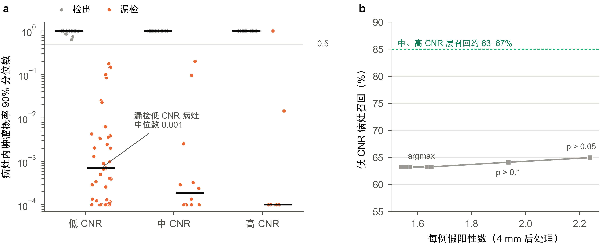
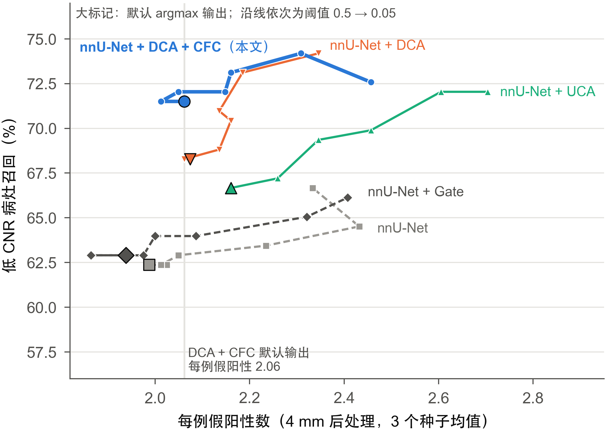
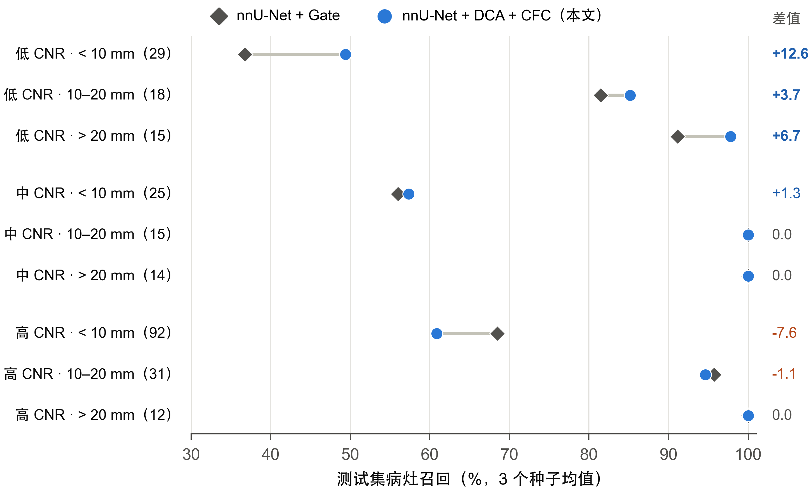
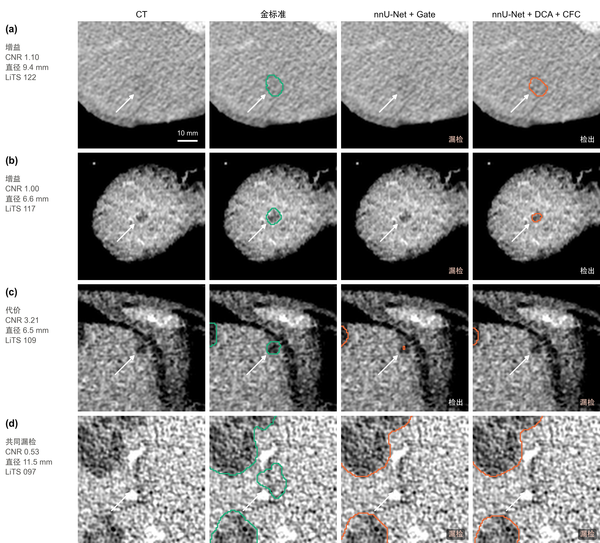

# 可检出性引导的对比度衰减训练：提高 CT 低对比度肝肿瘤的检出

> **版本说明（投稿前删除）**
>
> - 本稿基于 2026-10-13 完成的一次性测试集评估（冻结协议 `c2b8cae`，结果 `results/test_protocol/`）。所有数字来自仓库中已归档的结果文件，出处在正文或表注中给出。
> - 图由 `manuscript/figures/src/figs_detect.py` 从已归档的结果文件生成（图 1–4）。
> - 方法名称暂定为 DCA（可检出性校准的对比度衰减）与 CFC（对比度不变特征一致性），可再议。
> - 目标期刊：Engineering Applications of Artificial Intelligence（EAAI）。英文稿在中文稿定稿后再写。

---

## 摘要

**背景：**CT 上肝肿瘤自动分割的主要残余错误之一，是漏检与周围肝实质对比度很低的病灶。在 LiTS 训练集的 518 个病灶中，病灶-肝脏对比噪声比（CNR）的中位数只有 1.62；在我们的基线上，低 CNR 层病灶的召回比中、高 CNR 层低约 20 个百分点。

**方法：**我们先对基线的漏检做诊断。漏检的低 CNR 病灶内，基线输出的肿瘤概率 90% 分位数中位数仅为 0.001，降低判定阈值几乎不能找回它们。在此基础上，网络结构上的改动（相位一致性频带路由、多尺度对比门控）也没有提高低 CNR 召回。这说明问题出在网络学到的表示，而不在决策阈值或网络结构。据此，我们提出两个只在训练时使用的模块：（1）**可检出性校准的对比度衰减（DCA）**：把真实病灶的平均强度向其周围肝实质环带平移，使病灶 CNR 降到从训练集低 CNR 层经验分布中抽取的目标值，同时保留病灶纹理和形状；（2）**对比度不变特征一致性（CFC）**：要求同一网络在衰减后图块上的解码器特征，在病灶附近与原图块的特征保持一致。两个模块不改变网络结构，推理时没有任何额外计算。

**实验：**基于 VoComni 预训练的三维 nnU-Net，在 LiTS 上按病人划分为 83/21/27 例（训练/验证/测试）。方法的选择规则、主要终点和统计方法在测试前写入冻结协议，27 例测试集只评估一次。主要终点为 4 mm 后处理后的低 CNR 层病灶召回（IoU > 0.1 一对一匹配），每组 3 个随机种子取均值。

**结果：**测试集包含 62 个低 CNR 病灶，分布在 19 例中。完整方法（DCA + CFC）的低 CNR 召回为 71.5%，相对同预训练、同训练预算的 nnU-Net 基线（62.4%）提高 9.1 个百分点（95% CI [3.0, 14.4]，Holm 校正 p = 0.006），相对已有门控模块基线（62.9%）提高 8.6 个百分点（[2.1, 14.6]，p = 0.011）。每例假阳性数从 1.99 变为 2.06，逐病例肿瘤 Dice 从 74.6% 变为 74.0%。在不超过本方法假阳性水平的任何阈值下，基线的低 CNR 召回都不超过 64%。逐个去掉病例重算，主要差值最低为 6.7 个百分点。在来自另一家机构的 303 例外部数据（MSD Task08，按同一协议评估）上，低 CNR 召回从 70.9%（门控基线）和 70.7%（基线）提高到 78.4%（+7.5 和 +7.7 个百分点，Holm p 均 < 0.001），但每例假阳性增加 0.77–0.97（因外部标注可能不完整，为上限）。

**结论：**针对可检出性构造训练样本，可以在不改动网络、不增加推理开销的前提下，显著提高低对比度肝肿瘤的检出。代价是高对比度小病灶的召回有所下降，这一点在临床使用时需要权衡。

**关键词：**肝肿瘤分割；低对比度病灶；可检出性；数据增强；一致性正则；nnU-Net；LiTS

---

## 1 引言

### 1.1 问题

增强 CT 是肝肿瘤检出与分期的标准影像手段，体素级的肿瘤勾画用于体积测量、手术与消融规划和疗效评估。LiTS 基准 \cite{bilic2023lits} 显示，肝脏分割已接近解决，而肿瘤分割仍有明显差距；基准作者还指出，分割指标好的方法不一定是好的病灶检测器。

造成这一差距的一个重要因素是病灶与周围实质的对比度。我们用病灶-肝脏对比噪声比（CNR）度量：病灶平均强度与病灶外 2–6 个体素的肝脏环带平均强度之差的绝对值，除以环带强度的标准差。在训练集 518 个病灶中，CNR 中位数为 1.62（范围 0.02–5.37），三分位点为 1.28 和 1.92。也就是说，三分之一的病灶 CNR 低于 1.28，这类病灶在单期增强 CT 上本身就难以辨认。

在我们的强基线（VoComni 预训练的三维 nnU-Net）上，验证集低 CNR 层的病灶召回为 64%，中、高 CNR 层为 83–87%。三个随机种子都漏检的 20 个病灶中，13 个属于低 CNR 层。低对比度漏检因此是这一任务中最主要的可改进空间。

### 1.2 现有思路及其局限

提高小病灶、难病灶检出的工作主要有三条路线。

**网络结构。**大量工作在 U-Net 中加入注意力、多尺度融合、边界引导或频域分支 \cite{cheng2024egunetr,hu2024msml,ma2025msffe,jiang2025texlivernet,han2025frequency}。但在严格配置的 nnU-Net 基线下，许多结构改进的收益并不稳定 \cite{isensee2024revisited}。我们自己也尝试了两种针对对比度设计的结构模块（第 3.3 节），都没有提高低 CNR 召回。

**损失函数。**实例级损失让每个病灶在损失中有同等权重，如 blob loss \cite{kofler2023blob} 和基于 CC-Metrics \cite{jaus2025ccmetrics} 的 CC-DiceCE \cite{bouteille2026ccdicece}。它们能提高召回，但常伴随精确率下降 \cite{bouteille2026ccdicece}。

**数据增强与合成。**病灶级复制粘贴（TumorCP \cite{yang2021tumorcp}、Soft-CP \cite{dai2022softcp}）在病灶层面做几何与强度扰动；合成肿瘤方法 \cite{hu2023labelfree,chen2024difftumor} 在健康肝脏中生成形状、纹理和强度可控的病灶；窗位平移增强 \cite{ostmo2023window} 针对因造影时相不佳而对比度低的病例。这些方法的强度扰动都不以"可检出性"为目标：它们不知道哪些对比度区间是模型的薄弱环节，扰动后病灶的 CNR 也不受控制。

### 1.3 本文思路

我们先回答一个问题：基线为什么漏检低对比度病灶？第 3 节的诊断给出三点结论：

1. **不是阈值问题。**漏检的低 CNR 病灶内，肿瘤概率 90% 分位数的中位数为 0.001，肝脏概率为 0.993。在假阳性预算内把判定阈值降到 0.1，低 CNR 召回只增加 0.9 个百分点。
2. **信息存在于图像中。**在训练集 173 个低 CNR 病灶上，以肝实质为参照的多尺度强度对比，比原始强度更能把病灶与背景肝实质分开（AUC 0.825 vs 0.750）。
3. **结构改动无效。**相位一致性频带路由的收益全部来自减少小假阳性，可被 4 mm 后处理替代；以肝实质为参照的多尺度对比门控没有提高低 CNR 召回。

这三点指向同一个解释：低 CNR 病灶在训练数据中样本少，网络没有学会在这一对比度区间上做出判断。因此我们不改网络，而改训练样本的可检出性分布。

### 1.4 贡献

1. **漏检诊断。**结合 CNR 分层、漏检病灶概率分析和结构干预实验，说明基线的低对比度漏检是表示层面的问题，不能靠调阈值或加结构模块解决。
2. **两个即插即用的训练模块。**DCA 按训练集低 CNR 层的经验分布，把真实病灶的对比度精确衰减到目标值，保留纹理与形状；CFC 约束衰减前后的解码器特征一致。两者不改变网络结构，推理零开销，参数全部来自训练集统计，不在验证集上调。
3. **事先登记的评测。**方法选择规则、主要终点、比较对象和统计方法在测试前冻结；27 例测试集只评估一次。我们同时报告同等假阳性下的比较、逐病例留一敏感性分析和按 CNR × 大小的分层结果，包括本方法的代价；并在另一家机构的 303 例数据上按同一协议做了外部验证。

---

## 2 相关工作

**肝肿瘤分割。**H-DenseUNet 结合 2D 层内特征与 3D 层间上下文 \cite{li2018hdenseunet}。nnU-Net 自动配置预处理、网络和训练流程，在许多三维任务上达到最优 \cite{isensee2021nnunet}。Swin UNETR \cite{hatamizadeh2022swinunetr}、MedNeXt \cite{roy2023mednext}、U-Mamba \cite{ma2024umamba} 等引入长程建模；VoCo 系列在大规模 CT 上预训练三维编码器 \cite{wu2024voco,wu2024largescale}。大规模复评发现，许多相对 nnU-Net 的改进在严格验证下消失 \cite{isensee2024revisited}。本文的方法与网络结构无关，以同预训练、同训练预算的 nnU-Net 为基线。

**实例级损失。**blob loss 对每个真值连通域单独计算 Dice，避免大病灶主导损失 \cite{kofler2023blob}。CC-DiceCE 用 Voronoi 划分为每个真值连通域分配区域，在区域内计算 DiceCE 并取平均 \cite{bouteille2026ccdicece,jaus2025ccmetrics}。在五个脑 MRI 数据集上，CC-DiceCE 在多数数据集上提高召回，但在 BraTS 上精确率显著下降 \cite{bouteille2026ccdicece}。

**病灶级增强与合成。**TumorCP 在线地把肿瘤从一个病例复制到另一个病例，并对复制对象做几何和强度变换 \cite{yang2021tumorcp}；Soft-CP 离线混合，并用 gamma、模糊和噪声扰动病灶强度 \cite{dai2022softcp}。Hu 等在健康肝脏中合成形状、纹理和强度可控的肿瘤，仅用合成肿瘤训练即可接近真实标注的效果 \cite{hu2023labelfree}；DiffTumor 用扩散模型合成可跨器官泛化的早期肿瘤 \cite{chen2024difftumor}；Pixel2Cancer 用元胞自动机模拟肿瘤的生长、侵袭和坏死来合成肿瘤 \cite{lai2024pixel2cancer}。窗位平移增强在训练时随机移动 CT 窗位，提高了造影时相不佳病例上的肝病灶分割 \cite{ostmo2023window}。与这些方法相比，DCA 不生成新病灶，只改变真实病灶的可检出性：病灶的形状、纹理和解剖上下文都是真实的，而对比度被精确控制在模型的薄弱区间内。

**可检出性。**在信号检测理论中，Rose 模型把均匀背景中目标的可检出性与对比噪声比联系起来 \cite{rose1948sensitivity}，这也是 CT 影像质量评价中对比度-细节分析的基础。我们借用这一视角，用 CNR 刻画病灶的可检出性，并据此构造训练样本。

---

## 3 漏检诊断

本节所有分析只使用训练集和验证集（21 例，其中 18 例含肿瘤），不涉及测试集。

### 3.1 漏检集中在低 CNR 层

按训练集 518 个病灶冻结的 CNR 三分位点（1.28、1.92）分层，基线 A0 在验证集上的低 CNR 层召回为 64.1%，中、高 CNR 层为 83–87%。漏检体素是假阳性体素的 2.7 倍。低 CNR 漏检可分为两类：

- **大而淡：**中位直径 15.5 mm，中位 CNR 0.48。网络只在病灶内点亮一个很小的区域（中位 22 个体素，约占病灶的 0.7%），IoU 达不到 0.1，被记为漏检，同时多出一个假阳性。
- **小而淡：**中位直径 8.2 mm，中位 CNR 0.85。病灶内的肿瘤概率接近 0，完全没有被看到。

### 3.2 降低阈值无法找回

我们在验证集上导出基线三个种子的 softmax 概率（推理设置与训练结束时的验证相同），分析漏检病灶内的概率分布（表 1）。漏检的低 CNR 病灶（≥ 50 体素）内，肿瘤概率最大值的中位数为 0.352，90% 分位数的中位数仅为 0.001，肝脏概率均值的中位数为 0.993，99.8% 的体素被判为肝脏。

在每例假阳性数不超过 argmax 点 + 0.5 的约束下扫描判定阈值 {0.5, 0.4, 0.3, 0.2, 0.1, 0.05}，最好的阈值（0.1）使低 CNR 召回从 63.3% 升到 64.1%（+0.9 个百分点），每例假阳性从 1.63 升到 1.94。漏检病灶不是"差一点被判为肿瘤"，而是被网络明确判为肝脏（图 1）。

{width=17cm}

**表 1** 基线 A0 漏检病灶（≥ 50 体素）内的概率统计（验证集，3 个种子，中位数）

| CNR 层 | 肿瘤概率最大值 | 肿瘤概率 90% 分位数 | 肝脏概率均值 | 判为肝脏的体素比例 |
|---|---:|---:|---:|---:|
| 低 | 0.352 | 0.001 | 0.993 | 0.998 |
| 中 | 0.001 | 0.000 | 0.999 | 1.000 |
| 高 | 0.000 | 0.000 | 0.730 | 0.784 |

### 3.3 结构模块没有提高低 CNR 召回

我们在同一基线上测试了两类针对对比度的结构模块（详见补充材料）。

**相位一致性频带路由（PhASER）。**在五个编码器跳连上，以相位一致性为条件对小波频带重新加权。相对 A0，它减少了假阳性体素（275.9k → 208.9k），但低 CNR 召回不变。推理时把相位一致性图置零，每例假阳性反而减少 0.17，召回在所有干预下都不变。仅用 15 个参数的梯度门控（A1）就能复现同样的效果。把直径 < 4 mm 的预测连通域删掉后，A0 的每例假阳性从 3.48 降到 1.72，A1 相对 A0 的优势基本消失。

**以肝实质为参照的多尺度对比门控（A9）。**在跳连上加入由多尺度中心-环带强度对比图驱动的门控。4 mm 后处理后，其低 CNR 召回与 A1 相同（66.7% vs 66.7%），停止开发。

### 3.4 信息存在于图像中

在训练集 173 个低 CNR 病灶上，我们比较了几种图像特征区分病灶与远处肝实质的能力（病灶级 AUC 的中位数）。原始强度为 0.750；以肝实质为参照的多尺度强度对比为 0.825，配对增益 +0.055（病例级 bootstrap 95% CI [0.018, 0.086]）。纹理特征没有区分能力（0.515）。这说明低 CNR 病灶在更大尺度的平均强度上仍可与肝实质区分，网络漏检它们不是因为图像中没有信息。

### 3.5 小结

漏检的原因在于网络学到的表示：对低对比度病灶，网络给出的是确定的"肝脏"判断，而不是不确定的判断；改变网络结构没有改变这一点。一个自然的解释是训练数据中低 CNR 病灶太少（训练集三分之一），而网络对每个病灶只见过它原有的对比度。这引出本文的方法：在训练时系统地构造低可检出性的样本。

---

## 4 方法

### 4.1 概述

图 2 给出整体流程。

{width=17cm}

记输入图块为 $x$，标签为 $y \in \{0, 1, 2\}$（背景、肝脏、肿瘤）。训练时，DCA 以概率 $p$ 生成衰减图块 $\tilde{x}$；网络 $f_\theta$ 在 $\tilde{x}$ 上用标准的深监督 DiceCE 训练；若有病灶被衰减，CFC 再用同一网络在原图块 $x$ 上的特征约束 $\tilde{x}$ 上的特征。推理时只运行 $f_\theta$，与基线完全相同。

### 4.2 可检出性校准的对比度衰减（DCA）

**病灶与环带。**对标签中每个 26 连通的肿瘤连通域 $M_k$（体素数 ≥ 20），定义其肝实质环带

$$
R_k = \big(\mathcal{D}_6(M_k) \setminus \mathcal{D}_1(M_k)\big) \cap \{y = 1\} \setminus \mathcal{D}_1\Big(\textstyle\bigcup_{j \neq k} M_j\Big), \tag{1}
$$

其中 $\mathcal{D}_r$ 表示切比雪夫半径为 $r$ 的膨胀，即环带由病灶外 2–6 个体素的肝脏体素组成，并排除其他病灶附近的体素。环带体素少于 10 个的病灶不处理。

**测量 CNR。**在网络输入（nnU-Net 的 CT 归一化之后）上计算病灶均值 $\mu_k$、环带均值 $\nu_k$ 与环带标准差 $s_k$：

$$
\mathrm{CNR}_k = \frac{|\mu_k - \nu_k|}{s_k}. \tag{2}
$$

CT 归一化是全局仿射变换，CNR 对它不变，因此与第 1 节在 HU 上定义的 CNR 一致。这里的环带用切比雪夫膨胀近似评测时的欧氏距离环带，并且只在图块内计算。

**目标 CNR。**设 $F$ 为训练集低 CNR 层（CNR < 1.28 的 173 个病灶）CNR 的经验分布。对每个病灶抽取 $u \sim \mathcal{U}(0, 1)$，取目标 $t_k = F^{-1}(u)$（用 0%、5%、…、100% 共 21 个分位点线性插值），令

$$
\alpha_k = \min\!\left(1, \frac{t_k}{\mathrm{CNR}_k}\right). \tag{3}
$$

$\alpha_k = 1$ 的病灶（本来就比目标更淡）不处理。

**衰减。**把病灶强度整体向环带均值平移：

$$
\tilde{x} = x - (1 - \alpha_k)(\mu_k - \nu_k)\, w_k, \qquad w_k = \max\!\big(G_\sigma * M_k,\; M_k\big) \odot \mathbb{1}[y > 0] \odot \big(1 - \textstyle\bigcup_{j \neq k} M_j\big), \tag{4}
$$

其中 $G_\sigma$ 为 $\sigma = 1$ 体素的高斯核，用于软化病灶边缘；后两项保证肝外组织和其他病灶不被改变。病灶内部 $w_k = 1$，平移量为常数，因此病灶纹理（强度相对均值的起伏）完全保留，CNR 近似变为 $\alpha_k \mathrm{CNR}_k = t_k$。边缘软化会轻微改变环带统计，所以这里是"近似"。

**采样。**每个训练样本以 $p = 0.5$ 的概率启用 DCA；启用时每个符合条件的病灶独立抽取目标。标签不变。

**与均匀衰减的区别。**一个更简单的做法是对每个样本抽取 $\alpha \sim \mathcal{U}(0.3, 1)$（第 5 节的 A11）。在这种做法下，高 CNR 病灶衰减后大多仍在中、高 CNR 层。DCA 让每个被衰减的病灶都落入基线失败的 CNR 区间，而且这个区间由训练集统计决定，不需要在验证集上调参。

### 4.3 对比度不变特征一致性（CFC）

DCA 只改变训练样本。为了让网络在病灶变淡时保持同样的表示，我们加入特征层面的一致性约束。设 $\Omega$ 为所有被衰减病灶的并集再膨胀 6 个体素后的区域。用同一网络、不回传梯度地计算原图块的解码器特征 $\bar{F}^{(s)} = \mathrm{sg}[F^{(s)}_\theta(x)]$，以及衰减图块的特征 $F^{(s)}_\theta(\tilde{x})$，其中 $s$ 取最细的两个解码器尺度（全分辨率和 1/2 分辨率）。一致性损失为

$$
\mathcal{L}_{\mathrm{CFC}} = \frac{1}{|S|} \sum_{s \in S} \frac{\sum_{v} \Omega_s(v)\,\big(1 - \cos\big(F^{(s)}_\theta(\tilde{x})_v,\; \bar{F}^{(s)}_v\big)\big)}{\sum_{v} \Omega_s(v)}, \tag{5}
$$

其中 $\Omega_s$ 是 $\Omega$ 按最大池化下采样到尺度 $s$ 的结果，余弦相似度沿通道维计算。没有病灶被衰减的批次不计算这一项，也不做原图块的前向。

选择余弦距离而不是均方误差，是因为它与特征的整体尺度无关；选择 stop-gradient，是为了让原图块的表示作为目标，而不是让两者向彼此靠拢。

### 4.4 总损失与训练

$$
\mathcal{L} = \mathcal{L}_{\mathrm{DiceCE}}\big(f_\theta(\tilde{x}), y\big) + \lambda\,\psi(e)\,\mathcal{L}_{\mathrm{CFC}}, \qquad \psi(e) = \min\!\left(1, \frac{e + 1}{5}\right), \tag{6}
$$

其中 $\mathcal{L}_{\mathrm{DiceCE}}$ 为 nnU-Net 的深监督 Dice + 交叉熵，$e$ 为 epoch 序号，$\lambda = 1$。DCA 的 $p$、目标分布、CFC 的尺度数、膨胀半径和 $\lambda$ 都在训练前固定，没有调参。

### 4.5 计算开销

DCA 只对病灶包围盒做局部运算；连通域标记在 CPU 上完成。CFC 每个批次多一次不回传梯度的前向。在 RTX 3080 Ti 上，完整方法每个 epoch 约 93 秒，只用 DCA 约 87 秒，均匀衰减（A11）约 85–90 秒；显存峰值约 10.2 GB（只用 DCA 为 9.0 GB）。推理时两个模块都不运行，参数量（31.2 M）和推理开销与基线相同。

---

## 5 实验设置

### 5.1 数据

LiTS 训练集 131 例 \cite{bilic2023lits}，按病人划分为训练 83 例、验证 21 例（18 例含肿瘤）、测试 27 例（24 例含肿瘤）。验证集共 92 个病灶，其中低 CNR 39 个；测试集共 253 个病灶，其中低 CNR 62 个，分布在 19 例中。CNR 三分位点在训练集病灶上计算并冻结（1.28、1.92）。

**外部数据。**外部验证使用医学分割十项全能（MSD）挑战的 Task08 肝血管数据 \cite{simpson2019msd,antonelli2022msd}：303 例有标注的门静脉期 CT，来自纪念斯隆-凯特琳癌症中心，不在 LiTS 的来源机构之中。我们用体素网格和强度指纹把这 303 例与本研究可获得的 151 例 LiTS CT 逐一比对，没有网格一致的配对，最小指纹差为 9.97 HU（判定重复的阈值为 2 HU），据此认为两者独立。Task08 只标注血管（1）和肿瘤（2），不标注肝脏；共 544 个肿瘤连通域，其中 211 例（70%）只有 1 个，提示部分病例可能只标注了目标病灶。层厚中位数为 5 mm。

### 5.2 实现

所有组使用相同的网络和训练设置（表 2），只在训练时的增强或损失上不同。网络为三维 nnU-Net `PlainConvUNet` \cite{isensee2021nnunet}，六个编码阶段的通道数为 32–320，由 VoComni 预训练权重初始化 \cite{wu2024voco,wu2024largescale}。所有模型使用最终 epoch 的权重，不做检查点选择。

**表 2** 训练设置

| 项目 | 设置 |
|---|---|
| 框架 | nnU-Net v2，PyTorch 2.1，CUDA 11.8 |
| 体素间距 / 图块 / 批大小 | 1.0 × 0.78 × 0.78 mm / 128³ / 2 |
| 初始化 | VoComni |
| 训练长度 | 200 epoch × 250 次迭代 |
| 优化器 | SGD，Nesterov 动量 0.99，初始学习率 5 × 10⁻³（编码器 0.3×、解码器 0.5×），多项式衰减 |
| 其他 | 权重衰减 3 × 10⁻⁵；梯度裁剪 12；混合精度 |
| 数据增强 | nnU-Net 默认增强；本方法的 DCA 在其之后、送入网络之前执行 |
| 推理 | 滑窗步长 0.5，Gaussian 加权，不做测试时增强 |
| 后处理 | 删除等效直径 < 4 mm 的预测肿瘤连通域（所有组相同） |
| 硬件 | 每个模型一张 RTX 3080 Ti（12 GB） |

### 5.3 对比组

| 组 | 内容 | 种子 |
|---|---|---|
| A0 | nnU-Net + VoComni，无额外模块 | 0, 1, 2 |
| A1 | A0 + 跳连门控（第 3.3 节的结构基线） | 0, 1, 2 |
| A12 | A0 + CC-DiceCE（按 \cite{bouteille2026ccdicece} 复现，与全局 DiceCE 1:1 相加） | 0 |
| A11 | A0 + 均匀对比度衰减（$\alpha \sim \mathcal{U}(0.3, 1)$） | 0, 1, 2 |
| A13a | A0 + DCA | 0, 1, 2 |
| A14（Pixel2Cancer）† | A0 + Pixel2Cancer 合成肿瘤 \cite{lai2024pixel2cancer}（离线变体，p = 0.9）；冻结协议之后新增 | 0, 1, 2 |
| **A13b（本文方法）** | **A0 + DCA + CFC** | **0, 1, 2** |

A12 的实现与原文有以下差异：Voronoi 划分在 1/2 分辨率上计算；Dice 使用很小的平滑项（10⁻⁵）；任务为三类，逐连通域损失针对"肿瘤 vs 其余"；训练 200 epoch。

**合成肿瘤方法（Pixel2Cancer）。**为与近年的合成肿瘤方法比较，我们在冻结协议之后新增了 Pixel2Cancer \cite{lai2024pixel2cancer}：它用元胞自动机模拟肿瘤的生长、侵袭和坏死，在肝实质中合成肿瘤，不使用学习得到的生成模型，因而不会接触测试数据。我们直接调用其公开代码，为 83 例训练病例各离线生成 10 个变体（在 1 mm 各向同性网格上合成后映射回预处理网格），训练时以原文的概率 0.9 把训练样本换成随机变体，并把合成肿瘤加入前景采样；其余设置与基线完全相同，3 个种子。这一组在测试集解锁之后加入，测试集结果只作描述，不做假设检验。基于生成模型的方法（DiffTumor \cite{chen2024difftumor}、FreeTumor 等）公开的生成模型在包含 LiTS 的数据上训练，直接使用会接触本研究的测试病例，因此没有纳入。

**参考架构。**我们另外报告 TriALS 基准 \cite{elbatel2026trials} 中 8 种架构在同一划分上的结果：三维 nnU-Net \cite{isensee2021nnunet}、SegResNet \cite{myronenko2018segresnet}、U-Mamba（UMambaBot）\cite{ma2024umamba}、MedNeXt-L \cite{roy2023mednext}、Swin UNETR \cite{hatamizadeh2022swinunetr}、二维 nnU-Net，以及 SAMed-B/H \cite{zhang2023samed}。它们按 TriALS 的默认设置训练（100 epoch、从头训练、单种子），测试集预测在本研究开发之前（2026 年 8 月）生成，开发过程中没有查看。我们只用本研究的评估流程（同一金标准、同一匹配规则、冻结的 CNR 三分位和 4 mm 后处理）重新计算它们已有预测的指标，不重新推理。由于训练轮数和预训练都与本研究不同，这些结果只作参考；同预算的比较是 A0 与本文方法。测试集预测使用训练中按验证折 EMA 伪 Dice 选出的 checkpoint_best，不使用测试时增强（本研究的模型使用 checkpoint_final）；SAMed-H 在最后约 15 个 epoch 训练崩塌（伪 Dice 降为 0），所用权重为第 79 个 epoch 的最佳权重。各模型训练结束时生成的验证集预测来自最终权重，与上述测试集权重不一致，因此不使用。

**架构迁移（S0 / S13b）。**为检验方法能否用于其他网络，我们把 TriALS 配置的 SegResNet（init_filters 32，blocks_down [1, 2, 2, 4]，blocks_up [1, 1, 1]，Adam，学习率 10⁻⁴，权重衰减 10⁻⁵，无深监督，从头训练）放进本研究的训练流程，训练 S0（SegResNet）与 S13b（SegResNet + DCA + CFC，设置与 A13b 完全相同），各 2 个种子、200 epoch。CFC 使用 SegResNet 最细两层解码器的输出。为在 12 GB 显存上保持批大小 2、图块 128³，训练时对每个编码/解码块使用梯度检查点，不改变计算结果。

### 5.4 评价指标

- **病灶检出：**真值与预测肿瘤分别按 26 连通标记，IoU > 0.1 的一对一匈牙利匹配。报告病灶召回、每例假阳性连通域数（FP/scan）和病灶 F1。
- **分层：**按冻结的 CNR 三分位（低、中、高）与病灶等效直径（< 10、10–20、> 20 mm）。
- **分割：**含肿瘤病例的逐病例肿瘤 Dice。
- **边界与体积（描述性）：**VOE、RVD、ASSD、HD95 和 MSSD（最大对称表面距离），表面距离按体素间距计算；含肿瘤病例若没有肿瘤预测，表面距离取图像对角线长度。
- **同等假阳性比较：**导出 softmax 概率，在阈值 {argmax, 0.5, 0.4, 0.3, 0.2, 0.1, 0.05} 上重新计算（均做 4 mm 后处理），比较在不超过本方法假阳性水平时各组可达到的最高低 CNR 召回。

### 5.5 开发与测试流程

所有开发决定只用验证集，并在执行前写入计划文档的变更记录：

1. **单种子筛选：**A9、A11、A12 在种子 0 上训练。继续条件为：4 mm 后处理后，低 CNR 召回比 A1 至少高 5 个百分点，且每例假阳性最多多 0.3。
2. **多种子复现：**A11、A13a、A13b 各 3 个种子。条件为：相对 A1 三种子均值，平均低 CNR 召回至少高 5 个百分点、平均每例假阳性最多多 0.3，且至少 2 个种子单独满足。
3. **方法选择：**按 A13b → A13a → A11 的事先固定顺序，第一个满足复现条件的组为本文方法。这一顺序不是按验证集成绩排序。
4. **冻结与测试：**选定方法后，把组别、后处理、主要终点、比较对象和统计方法写入冻结协议并提交，然后对 27 例测试集一次性推理和评估。

**主要终点**为 4 mm 后处理后的低 CNR 病灶召回（病灶汇总），每组取 3 个种子的均值。**确认性比较**只有两个：本文方法 vs A1（主要）和本文方法 vs A0（次要），做 Holm 校正，双侧 α = 0.05。统计采用按病例的配对 bootstrap（10 000 次，固定随机种子）：每次重采样测试病例，在重采样病例上对每个种子计算汇总召回，再取 3 个种子的均值求组间差。只有校正后 p < 0.05 且 95% CI 不含 0 时才写"提高"。其他所有比较只做描述。

---

## 6 结果

### 6.1 验证集上的开发结果

**表 3** 验证集结果（21 例，4 mm 后处理，3 个种子均值；A12 为单种子；† 为冻结协议之后新增的对比组，只作描述）

| 组 | 低 CNR 召回（%） | 全部病灶召回（%） | FP/scan | 肿瘤 Dice（%） | 病灶 F1（%） |
|---|---:|---:|---:|---:|---:|
| A0 | 63.2 | 75.7 | 1.62 | 66.1 | 71.2 |
| A1 | 65.8 | 77.2 | 1.56 | 68.1 | 72.6 |
| A12 | 76.9 | 82.6 | 2.86 | 70.5 | 66.7 |
| A11 | 75.2 | 81.9 | 1.65 | 71.5 | 74.6 |
| A13a | 76.9 | 82.6 | 1.56 | 73.6 | 75.8 |
| A14（Pixel2Cancer）† | 73.5 | 79.4 | 2.21 | 64.8 | 69.1 |
| A13b | 73.5 | 80.8 | 1.76 | 71.5 | 73.1 |

单种子筛选中，A9 的低 CNR 召回增益为 0，停止；A12 增益 +10.3 个百分点，但每例假阳性增加 1.33，停止；A11 增益 +7.7 个百分点、假阳性 +0.24，通过。多种子复现中 A11、A13a、A13b 都满足条件（相对 A1：+9.4、+11.1、+7.7 个百分点），按事先顺序选定 A13b 为本文方法。

验证集上有两点需要说明。第一，A13a 在验证集上优于 A13b，即 CFC 没有带来提升。第二，验证集的增益高度集中：A13b 比 A1 多检出的病灶（3 个种子合计 9 次）中有 8 次来自同一病例 LiTS_094；按冻结的统计方法在验证集上空跑，A13b vs A1 的 95% CI 为 [0.0, 14.5]，去掉 LiTS_094 后差值只剩 +1.3 个百分点。验证集结果因此不能作为方法有效的证据，独立证据只来自测试集。

### 6.2 测试集上的确认性比较

**表 4** 测试集主要终点（27 例，62 个低 CNR 病灶，4 mm 后处理，3 个种子均值；† 为冻结协议之后新增的对比组，只作描述）

| 组 | 低 CNR 召回（%） |
|---|---:|
| A0 | 62.4 |
| A1 | 62.9 |
| A11 | 66.7 |
| A13a | 68.3 |
| A14（Pixel2Cancer）† | 62.4 |
| **A13b（本文方法）** | **71.5** |

**与合成肿瘤方法的比较。**Pixel2Cancer（†）在验证集上的低 CNR 召回与本文方法相同（73.5%），但肿瘤 Dice 较低（64.8%）、每例假阳性较高（2.21）。在测试集上，它的低 CNR 召回与基线相同（62.4%），本文方法比它高 9.1 个百分点（配对 bootstrap 95% CI [1.9, 15.3]）；它的全部病灶召回（74.0%）和肿瘤 Dice（75.2%）略高于本文方法，差值区间都包含 0，每例假阳性相近（2.11 vs 2.06）。两个数据集上的方向不一致；验证集已用于开发、只有 39 个低 CNR 病灶，因此我们以测试集为主，但这一比较是描述性的。

**表 5** 确认性比较（配对 bootstrap 10 000 次，Holm 校正）

| 比较 | 角色 | 差值（个百分点） | 95% CI | Holm p | 结论 |
|---|---|---:|---|---:|---|
| A13b vs A1 | 主要 | +8.6 | [2.1, 14.6] | 0.011 | 提高 |
| A13b vs A0 | 次要 | +9.1 | [3.0, 14.4] | 0.006 | 提高 |

**留一病例敏感性。**逐个去掉 19 个含低 CNR 病灶的病例重算主要差值，最大的单例贡献为 +1.9 个百分点（LiTS_000），去掉后差值为 +6.7；其余病例的贡献在 −1.2 到 +1.6 之间。与验证集不同，测试集上的增益分布在多个病例中，不依赖单一病例。

### 6.3 同等假阳性下的比较

把判定阈值从 argmax 一路降到 0.05，基线的低 CNR 召回最高只到 66.7%（A0，每例假阳性 2.33），而本文方法在默认 argmax 下（每例假阳性 2.06）已达到 71.5%（表 6，图 3）。按冻结协议，以本文方法 argmax 点的平均假阳性（每例 2.06）为预算，逐个种子取预算内的最高低 CNR 召回再求均值：A0 为 62.9%（3 个种子都有阈值落在预算内），A1 为 63.7%（2 个种子），本文方法为 74.2%（2 个种子；另一个种子的所有阈值都略超预算）。也就是说，本文方法的提升不能通过放宽基线阈值得到。

**表 6** 测试集上不同判定阈值的每例假阳性 / 低 CNR 召回（%）（4 mm 后处理，3 个种子均值）

| 组 | argmax | 0.5 | 0.4 | 0.3 | 0.2 | 0.1 | 0.05 |
|---|---|---|---|---|---|---|---|
| A0 | 1.99 / 62.4 | 2.02 / 62.4 | 2.01 / 62.4 | 2.05 / 62.9 | 2.23 / 63.4 | 2.43 / 64.5 | 2.33 / 66.7 |
| A1 | 1.94 / 62.9 | 1.86 / 62.9 | 1.98 / 62.9 | 2.00 / 64.0 | 2.09 / 64.0 | 2.32 / 65.1 | 2.41 / 66.1 |
| A13a | 2.07 / 68.3 | 2.06 / 68.3 | 2.14 / 68.8 | 2.16 / 70.4 | 2.14 / 71.0 | 2.19 / 73.1 | 2.35 / 74.2 |
| **A13b** | **2.06 / 71.5** | 2.01 / 71.5 | 2.05 / 72.0 | 2.15 / 72.0 | 2.16 / 73.1 | 2.31 / 74.2 | 2.46 / 72.6 |

{width=12cm}

### 6.4 次要终点与分层结果

**表 7** 测试集次要终点（描述性，3 个种子均值；A12 为单种子；† 为冻结协议之后新增的对比组，只作描述）

| 组 | 全部病灶召回（%） | FP/scan | 肿瘤 Dice（%） | 病灶 F1（%） |
|---|---:|---:|---:|---:|
| A0 | 73.4 | 1.99 | 74.6 | 75.4 |
| A1 | 73.8 | 1.94 | 74.1 | 75.9 |
| A12 | 82.2 | 4.00 | 73.2 | 73.1 |
| A11 | 73.7 | 2.16 | 74.3 | 74.9 |
| A13a | 71.7 | 2.07 | 74.3 | 74.0 |
| A14（Pixel2Cancer）† | 74.0 | 2.11 | 75.2 | 75.3 |
| A13b | 73.1 | 2.06 | 74.0 | 74.9 |

本文方法的全部病灶召回、肿瘤 Dice 与基线基本持平，每例假阳性增加约 0.1。表 8 和图 4 的分层结果说明了原因：提升集中在低 CNR 病灶，尤其是低 CNR 的小病灶；代价是高 CNR 小病灶的召回下降。

{width=12cm}

**表 8** 测试集按 CNR × 大小分层的召回（%，3 个种子均值；括号内为病灶数）

| CNR 层 | 大小 | A0 | A1 | A13a | A13b |
|---|---|---:|---:|---:|---:|
| 低 | < 10 mm（29） | 36.8 | 36.8 | 46.0 | 49.4 |
| 低 | 10–20 mm（18） | 77.8 | 81.5 | 83.3 | 85.2 |
| 低 | > 20 mm（15） | 93.3 | 91.1 | 93.3 | 97.8 |
| 中 | < 10 mm（25） | 53.3 | 56.0 | 54.7 | 57.3 |
| 中 | 10–20 mm（15） | 97.8 | 100.0 | 100.0 | 100.0 |
| 中 | > 20 mm（14） | 100.0 | 100.0 | 100.0 | 100.0 |
| 高 | < 10 mm（92） | 68.5 | 68.5 | 62.3 | 60.9 |
| 高 | 10–20 mm（31） | 96.8 | 95.7 | 87.1 | 94.6 |
| 高 | > 20 mm（12） | 100.0 | 100.0 | 100.0 | 100.0 |

### 6.5 消融

**表 9** 消融：低 CNR 召回（%）/ 每例假阳性

| 配置 | 验证集 | 测试集 |
|---|---|---|
| 基线 A0 | 63.2 / 1.62 | 62.4 / 1.99 |
| + 均匀对比度衰减（A11） | 75.2 / 1.65 | 66.7 / 2.16 |
| + 可检出性校准，即 DCA（A13a） | 76.9 / 1.56 | 68.3 / 2.07 |
| + CFC，即完整方法（A13b） | 73.5 / 1.76 | 71.5 / 2.06 |

在测试集上，三步依次提高低 CNR 召回：对比度衰减本身 +4.3，可检出性校准 +1.6，特征一致性 +3.2 个百分点。在验证集上，前两步同样带来提升，但 CFC 使召回下降 3.4 个百分点。这些比较都是描述性的，不做假设检验。

### 6.6 与实例级损失的比较

CC-DiceCE（A12）在测试集上的全部病灶召回最高（82.2%），但每例假阳性为 4.00，约为其他组的两倍，病灶 F1 和肿瘤 Dice 都低于本文方法。它的低 CNR 召回（66.1%）也低于本文方法。这与原文在 BraTS 上观察到的精确率下降一致 \cite{bouteille2026ccdicece}：逐连通域损失通过放宽检出提高召回，而本文方法在几乎不增加假阳性的情况下，专门提高低对比度病灶的检出。

### 6.7 与主流架构的参考比较

**表 10** 测试集参考比较（4 mm 后处理；参考架构为 TriALS 默认设置下的单种子结果，使用 checkpoint_best、无测试时增强；本研究的组为 3 个种子均值，A12 为单种子；参数量为网络权重总数，* 含冻结的 SAM ViT-H 编码器，可训练参数 4.6 M；† 为冻结协议之后新增的对比组，只作描述）

| 模型 | 训练条件 | 低 CNR 召回（%） | 全部召回（%） | FP/scan | 肿瘤 Dice（%） | 病灶 F1（%） | 参数量（M） | 高 CNR < 10 mm 召回（%） |
|---|---|---:|---:|---:|---:|---:|---:|---:|
| nnU-Net 3D | 100 epoch，从头训练 | 56.5 | 66.8 | 5.00 | 56.3 | 60.7 | 31.2 | 63.0 |
| nnU-Net 2D | 100 epoch，从头训练 | 53.2 | 61.7 | 6.00 | 56.8 | 54.6 | 46.3 | 52.2 |
| SegResNet | 100 epoch，从头训练 | 58.1 | 68.8 | 3.81 | 60.7 | 65.7 | 18.8 | 63.0 |
| U-Mamba（Bot） | 100 epoch，从头训练 | 61.3 | 65.6 | 4.04 | 57.2 | 62.9 | 58.4 | 56.5 |
| MedNeXt-L | 100 epoch，从头训练 | 64.5 | 71.9 | 3.70 | 66.1 | 68.0 | 63.0 | 68.5 |
| SAMed-H | 100 epoch | 58.1 | 67.2 | 7.04 | 62.9 | 55.5 | 641.7* | 64.1 |
| A0（nnU-Net + VoComni） | 200 epoch，预训练 | 62.4 | 73.4 | 1.99 | 74.6 | 75.4 | 31.2 | 68.5 |
| A12（CC-DiceCE） | 200 epoch，预训练 | 66.1 | 82.2 | 4.00 | 73.2 | 73.1 | 31.2 | 83.7 |
| A14（Pixel2Cancer）† | 200 epoch，预训练 | 62.4 | 74.0 | 2.11 | 75.2 | 75.3 | 31.2 | 69.9 |
| **A13b（本文方法）** | 200 epoch，预训练 | **71.5** | 73.1 | 2.06 | 74.0 | 74.9 | 31.2 | 60.9 |

Swin UNETR（每例假阳性 35.7，肿瘤 Dice 24.1%）和 SAMed-B（全部病灶召回 5.1%）在 TriALS 设置下训练失败，结果见补充材料，未列入表 10。在可用的参考架构中，MedNeXt-L 的低 CNR 召回最高（64.5%），但每例假阳性约为本文方法的 1.8 倍。由于训练条件不同，这张表不能用于判断架构优劣；它说明的是，本文方法在低 CNR 召回上高于这些常用架构，而假阳性和分割质量保持在同预算基线的水平。TriALS 还保存了 nnU-Net 3D、SegResNet 和 U-Mamba 开启镜像测试时增强的测试集预测：按同一流程评估，低 CNR 召回分别为 56.5%、59.7% 和 61.3%，与不开时相差 0–1.6 个百分点，每例假阳性降到 3.19–3.59（补充材料），不改变上述比较。在高 CNR 小病灶（< 10 mm，92 个）上，本文方法的召回（60.9%）低于同预算基线和 MedNeXt-L（均为 68.5%）以及 CC-DiceCE（83.7%），与 nnU-Net 3D 和 SegResNet（63.0%）接近，高于 U-Mamba（56.5%）和 nnU-Net 2D（52.2%），与第 7.2 节讨论的代价一致。

### 6.8 迁移到 SegResNet

为检验方法能否用于其他网络，我们在 SegResNet 上比较了不加和加入 DCA + CFC 的两组。训练中，加入本文模块的一个种子在 FP16 下出现解码器激活溢出，改用 bf16 后在第 68–72 个 epoch 崩塌、只部分恢复（原因见 7.3 节）。

**表 11** SegResNet 上的迁移结果（4 mm 后处理；各 2 个种子；冻结后新增的描述性分析）

| 模型 | 种子 | 验证集低 CNR 召回（%） | 测试集低 CNR 召回（%） | 测试集全部召回（%） | 测试集 FP/scan | 测试集肿瘤 Dice（%） |
|---|---|---:|---:|---:|---:|---:|
| SegResNet | 0 | 74.4 | 54.8 | 68.0 | 2.67 | 67.6 |
| SegResNet | 1 | 74.4 | 61.3 | 70.4 | 2.78 | 67.8 |
| SegResNet + DCA + CFC | 0 | 61.5 | 58.1 | 53.0 | 3.04 | 53.9 |
| SegResNet + DCA + CFC | 1 | 5.1 | 9.7 | 9.1 | 6.89 | 12.0 |

在 SegResNet 上，本文方法没有带来提升。两个种子均值的测试集低 CNR 召回差为 −24.2 个百分点（配对 bootstrap 95% CI [−33.1, −14.1]），全部病灶召回差为 −38.1 个百分点，每例假阳性增加 2.24。均值主要受训练崩塌的种子影响；没有崩塌的种子在测试集上的低 CNR 召回与 SegResNet 相当（58.1% vs 54.8% 和 61.3%），但全部病灶召回和肿瘤 Dice 明显更低。两组的自动混合精度类型不同（SegResNet 为 FP16，加入本文模块后为 bf16）；由于没有单独训练 SegResNet + DCA，我们也无法区分 DCA 和 CFC 各自的作用。这一结果说明，本文方法的有效性目前只在 nnU-Net（解码阶段以实例归一化结束、使用预训练权重）上得到确认。结果文件见 `results/segresnet_transfer/`。

### 6.9 外部验证：MSD Task08

为检验结论能否推广到另一家机构的数据，我们在 MSD Task08 的 303 例上做了外部验证（5.1 节）。方案在任何 Task08 推理之前写入计划文档：模型为基线、门控基线和本文方法各 3 个种子（与测试协议相同的权重和推理设置，无测试时增强），CNR 定义、冻结的三分位点、病灶匹配规则、4 mm 后处理、主要终点、两项确认性比较、bootstrap 和 Holm 校正都与冻结协议相同。由于 CNR 的环带需要肝实质，而 Task08 没有肝脏标注，我们用一个固定规则构造参照：肝脏取基线 3 个种子预测的肝+肿瘤中至少 2 个一致的体素，肿瘤一律取 Task08 的肿瘤标签；所有模型使用同一参照。参照肝内的肿瘤体素比例中位数为 99.8%，303 例中只有 3 例低于 50%。

**表 12** MSD Task08 外部验证结果（303 例，544 个病灶，其中低 CNR 315 个，分布在 228 例中；4 mm 后处理；3 个种子均值）

| 方法 | 低 CNR 召回（%） | 全部召回（%） | FP/scan† | 肿瘤 Dice（%） | F1（%）† |
|---|---:|---:|---:|---:|---:|
| 基线 | 70.7 | 80.6 | 3.36 | 58.4 | 43.8 |
| 门控基线 | 70.9 | 80.8 | 3.55 | 58.4 | 42.7 |
| **本文方法** | **78.4** | **85.0** | 4.33 | **62.3** | 40.0 |

† Task08 的肿瘤标注可能不完整，部分"假阳性"可能是未标注的肿瘤，FP/scan 和 F1 只能作为上限参考。

本文方法的低 CNR 召回比门控基线高 7.5 个百分点（95% CI [4.3, 10.8]，Holm p < 0.001），比基线高 7.7 个百分点（[5.1, 10.6]，Holm p < 0.001），两项确认性比较都满足"提高"的条件。效应量与 LiTS 测试集（+8.6 和 +9.1）接近，由于低 CNR 病灶数是测试集的 5 倍，置信区间更窄。本文方法的 3 个种子（79.0%、77.8%、78.4%）都高于全部 6 个对照运行（69.5%–72.1%）；逐个去掉含低 CNR 病灶的病例重算主要差值，结果在 +7.1 到 +8.2 个百分点之间。按大小分层，低 CNR 病灶在 < 10 mm（45 个）、10–20 mm（80 个）和 > 20 mm（190 个）三层的召回分别从 36.3%、67.1%、80.7%（门控基线）提高到 43.0%、72.5%、89.3%。全部病灶召回和肿瘤 Dice 也分别比门控基线高 4.2 和 3.8 个百分点。

与 LiTS 测试集不同，外部数据上的假阳性明显增加：本文方法每例比门控基线多 0.77 个，比基线多 0.97 个（LiTS 测试集上为 +0.12 和 +0.07），F1 因此低于两个对照。这些假阳性中有多少是未标注的肿瘤，目前无法区分。此外，肝参照来自基线的预测，可能使 CNR 分层略偏向基线的肝边界；由于所有模型使用同一参照，这一偏差不改变比较的方向。

**假阳性的来源（事后描述性分析）。**为了解外部数据上增加的假阳性落在哪里，我们在运行前登记了一个描述性分析：把 4 mm 后处理后未匹配的预测连通域按固定优先级分为四类——与 Task08 肿瘤有重叠的碎片、肝外（< 50% 落在参照肝内）、血管（≥ 30% 落在膨胀 1 体素的血管标签内）和肝内其他。与门控基线相比，本文方法每例增加的 0.77 个假阳性中，肝内其他类增加 0.84 个（95% CI [0.70, 0.99]），且主要是直径 < 10 mm 的小区域（+0.73）；肝外增加 0.10，血管类增加 0.04，而与已标注肿瘤重叠的碎片减少 0.20（[−0.30, −0.11]），可能反映本文方法对已标注肿瘤的分割更完整。本文方法肝内其他类假阳性相对周围肝实质的对比度中位数为 1.54，低于门控基线的 1.91，提示新增的假阳性多为低对比度的小区域。增加量在只标注了 1 个肿瘤的 211 例（+0.75）和标注了多个肿瘤的 92 例（+0.84）中相近，因此不能简单地用"只标注了目标病灶"来解释。随机抽取的 16 个本文方法独有的假阳性（补充材料）中，多数为肝边缘、裂隙附近或均匀实质中的数毫米小区域，个别为可见的低密度灶；没有放射科医生复核，我们不对其性质下结论。一种可能的解释是，DCA 使网络对微弱的局部强度差更敏感，在扫描条件不同的外部数据上，这种敏感性同时带来了更多低对比度小区域的误报；本研究没有直接检验这一解释。结果文件见 `results/external_msd08/`（假阳性分析在 `fp_analysis/` 中）。

### 6.10 边界与体积指标

参考 LiTS 相关工作常用的指标，我们补充计算了 VOE、RVD、ASSD、HD95 和 MSSD（计算前登记，描述性）。肿瘤指标使用 4 mm 后处理后的预测，只在含肿瘤的病例上计算；肝脏指标比较预测的肝+肿瘤与金标准的肝+肿瘤。每个运行先取病例均值，再取 3 个种子的均值（表 13）。

**表 13** 测试集边界与体积指标（肿瘤：24 例含肿瘤病例；肝脏：27 例；Dice、VOE、RVD 为 %，距离为 mm；CC-DiceCE 为单种子；† 为冻结协议之后新增的对比组，只作描述）

| 方法 | 肿瘤 Dice | 肿瘤 VOE | 肿瘤 RVD | 肿瘤 ASSD | 肿瘤 HD95 | 肿瘤 MSSD | 肝脏 Dice | 肝脏 ASSD | 肝脏 HD95 |
|---|---:|---:|---:|---:|---:|---:|---:|---:|---:|
| 基线 | 74.6 | 38.9 | −12.4 | 6.25 | 39.1 | 68.9 | 96.8 | 1.57 | 10.2 |
| 门控基线 | 74.1 | 39.2 | −15.0 | 5.24 | 33.3 | 59.2 | 96.9 | 1.42 | 7.1 |
| CC-DiceCE | 73.2 | 40.2 | +1.0 | 10.08 | 58.4 | 86.4 | 96.5 | 2.06 | 15.4 |
| 均匀衰减 | 74.3 | 39.1 | −5.6 | 6.57 | 39.6 | 65.2 | 96.8 | 1.52 | 9.1 |
| DCA | 74.3 | 39.2 | −5.4 | 6.10 | 33.6 | 60.7 | 96.8 | 1.42 | 8.3 |
| Pixel2Cancer† | 75.2 | 38.5 | +2.7 | 5.00 | 35.1 | 61.4 | 96.7 | 1.32 | 6.4 |
| **本文方法** | 74.0 | 39.4 | −3.4 | 6.24 | 30.0 | 64.0 | 96.8 | 1.42 | 6.0 |

在测试集上，本文方法与门控基线的肿瘤边界指标相当：Dice 差 −0.1 个百分点（配对病例 bootstrap 95% CI [−2.7, 2.8]），ASSD 差 +1.0 mm（[−0.7, 3.2]），HD95 差 −3.3 mm（[−15.6, 8.1]），区间都包含 0。差别在体积上：门控基线的肿瘤体积平均低估 15.0%，本文方法只低估 3.4%（RVD 差 +11.6 个百分点，[4.7, 22.1]），与找回更多低对比度病灶的体积一致。肝脏分割不受影响（各组 Dice 均为 96.5%–96.9%）。Pixel2Cancer 的肿瘤 Dice、RVD 和 ASSD 略好于本文方法，HD95 略差（35.1 vs 30.0 mm），差值区间均包含 0（例如肿瘤 HD95 差 −5.1 mm，[−19.4, 8.4]）。作为参照，TriALS 中正常训练的 6 个参考架构（单种子）的肿瘤 HD95 为 41.7–81.5 mm，肝脏 Dice 为 90.9%–95.8%，均差于本研究预训练的同预算模型（补充材料），与表 10 中它们较低的肿瘤 Dice 一致。

在 MSD Task08 上（只评估肿瘤），本文方法的肿瘤 Dice 比门控基线高 3.8 个百分点（[2.6, 5.2]），VOE 低 3.2 个百分点（[−4.4, −2.1]），ASSD 从 18.2 mm 降到 12.8 mm（[−10.5, −1.3]）；其中一部分来自对照模型完全没有预测出肿瘤的病例（基线和门控基线 3 个种子合计分别为 13 和 6 例次，本文方法为 0），这些病例的表面距离按约定取图像对角线长度。HD95 相近（+2.4 mm，[−3.3, 7.7]），而 MSSD 高 12.8 mm（[6.9, 18.2]）：MSSD 取最大距离，对远离肿瘤的假阳性敏感，这与6.9 节中假阳性的增加一致。结果文件见 `results/boundary_metrics/`。

### 6.11 定性比较

{width=16cm}

为避免挑选，选例规则在作图前登记，只依据已归档的测试集病灶表：增益例为三个种子中本文方法全部检出、门控基线全部漏检的低 CNR 病灶，按直径从大到小取 2 个（满足条件的只有这 2 个）；代价例为门控基线全部检出、本文方法全部漏检的高 CNR 小病灶中直径最大者；失败例为六个运行都漏检的低 CNR 病灶中直径最大者。按原规则首先选出的代价例（LiTS_117 病灶 3）实际被本文方法覆盖了 98% 以上，只是在三维上与相邻的大病灶连成一个连通域，按一对一匹配计为漏检；由于这种合并型漏检只占代价的一小部分（7.2 节），我们在作图时把代价例的条件补充为"本文方法三个种子的覆盖率均 < 50%"，这一修订及其原因同样记录在计划文档中。

图 5（a）（b）中的两个病灶在肝窗下与周围实质几乎无法区分（CNR 1.10 和 1.00），门控基线完全没有预测，本文方法给出了位置正确的分割，但（b）的范围小于金标准。（c）是肝表面附近一个边界清楚的 6.5 mm 低密度灶，门控基线的预测很小但仍满足匹配条件，本文方法没有预测。（d）的病灶 CNR 仅 0.53，夹在两个较大的病灶之间，两种方法都分割出了相邻的大病灶，却都漏掉了它。

---

## 7 讨论

### 7.1 为什么改训练样本比改结构有效

第 3 节的诊断显示，漏检的低 CNR 病灶在基线中被稳定地判为肝脏，而图像中的多尺度对比信息足以区分它们。结构模块提供了更多的计算路径，但没有改变网络在训练中"见过什么"：训练集里低 CNR 病灶只占三分之一，而每个病灶只以原有的对比度出现。DCA 直接扩充了这一区间的样本，而且样本来自真实病灶，形状、纹理和解剖位置都是真实的。同等假阳性比较（6.3 节）表明，提升不是阈值移动的结果，而是网络对这类病灶的判断发生了改变。合成肿瘤方法的结果从另一面提示了这一点：Pixel2Cancer（A14）在肝实质中生成新病灶，但在测试集上没有提高低 CNR 召回；而把真实病灶的对比度校准到薄弱区间，提高了这类病灶的检出。

### 7.2 代价：高对比度小病灶

分层结果显示，本文方法使高 CNR 小病灶（< 10 mm，92 个）的召回从 68.5% 降到 60.9%。一种可能的解释是，经过衰减训练后，网络对"微弱的局部强度变化"的判断标准发生了变化，部分清晰但很小的结构被更保守地处理；另一种可能是 4 mm 后处理与这类病灶的大小接近。我们没有在本研究中区分这两种解释。为了解这一代价是否来自匹配规则，我们检查了按协议漏检的病灶被预测覆盖的比例（作图时发现合并现象后登记，描述性）：在这一层中，门控基线漏检 29 个、本文方法漏检 36 个（3 个种子均值）；其中预测基本没有覆盖（覆盖率 < 50%）的分别为 25.3 和 31.7 个，覆盖 ≥ 50% 但未匹配的分别为 3.7 和 4.3 个，后者几乎都是与相邻病灶在三维上合并。因此，这一代价主要是真正的漏检，而不是匹配规则造成的。作为对照，Pixel2Cancer（A14）在这一层的召回为 69.9%，没有出现这一代价，提示代价与对比度衰减本身有关，而不是扩充训练样本的普遍结果。临床使用时，这一取舍应与低对比度病灶漏检的代价一起考虑。

### 7.3 CFC 的作用尚不确定

CFC 在测试集上带来 +3.2 个百分点的描述性提升，但在验证集上使召回下降 3.4 个百分点。由于方法选择按事先固定的顺序进行，A13b 被选为本文方法，但两个数据集上的方向不一致，CFC 的独立贡献还不能确定。确认性检验只针对完整方法，因此这一不确定性不影响主要结论。SegResNet 上的迁移实验还揭示了 CFC 的一个适用条件：SegResNet 的解码块输出为残差和、其后没有归一化，尺度不变的余弦损失使特征幅值持续增长（一个种子的最大激活达到约 10⁷，不加本文模块时约 200–300），最终导致训练崩塌；nnU-Net 的每个解码阶段以实例归一化结束，不受影响。

### 7.4 局限

1. **划分与外部数据。**确认性结果来自 LiTS 的一个按病人划分，没有交叉验证。外部验证只用了 MSD Task08 一个数据集，其肿瘤标注可能不完整、不含肝脏标注，每例假阳性只能作为上限，肝参照来自基线模型的预测（6.9 节）；外部数据上假阳性的增加明显大于 LiTS，主要是肝内低对比度的小区域，其性质尚需放射科医生复核。
2. **验证集已用于开发。**筛选、复现和方法选择都在同一 21 例验证集上进行，验证集结果偏乐观，且其增益集中在单一病例。
3. **测试集规模。**测试集只有 62 个低 CNR 病灶，置信区间较宽（[2.1, 14.6]）。
4. **对比方法有限。**实例级损失只比较了 CC-DiceCE 的复现版本，合成肿瘤方法只比较了 Pixel2Cancer（A14，冻结协议之后新增、描述性），没有比较复制粘贴类增强和基于生成模型的合成方法；参考架构的训练条件与本研究不同，只能作参考。
5. **主干网络。**确认性结果只来自 nnU-Net；在 SegResNet 上的迁移实验（6.8 节，2 个种子，冻结后新增）中，本文方法没有带来提升，方法能否用于其他架构尚未确立。
6. **CNR 只刻画了平均强度差。**边界模糊、噪声纹理和部分容积效应同样影响可检出性，DCA 目前没有建模这些因素。

### 7.5 展望

DCA 的思路可以推广到其他低对比度病灶，如胰腺肿瘤和肾肿瘤。另一个方向是把评价也建立在可检出性之上：在测试时把真实病灶逐级衰减，画出模型的对比度-检出曲线，用"检出概率为 50% 时的 CNR"刻画模型能看见多淡的病灶。

---

## 8 结论

我们通过诊断发现，强基线对低对比度肝肿瘤的漏检是表示层面的问题，不能靠调阈值或增加结构模块解决。据此提出的两个训练模块——可检出性校准的对比度衰减和对比度不变特征一致性——不改变网络、不增加推理开销，在事先冻结协议的独立测试集上，把低 CNR 病灶召回相对同预算基线提高了 9.1 个百分点，且不依赖单一病例；在另一家机构的 303 例外部数据上，按同一协议得到的提升为 7.5–7.7 个百分点，但假阳性的增加也比 LiTS 上明显。代价是高对比度小病灶的召回下降，需要在应用中权衡。

---

## 数据与代码

LiTS 与 MSD Task08 均为公开数据集。代码、划分文件、冻结协议和全部结果文件将在 [[待填：仓库地址]] 公开。

## 参考文献

（由 `manuscript/tools/md2docx.py` 按引用顺序从 `refs.bib` 生成。）
